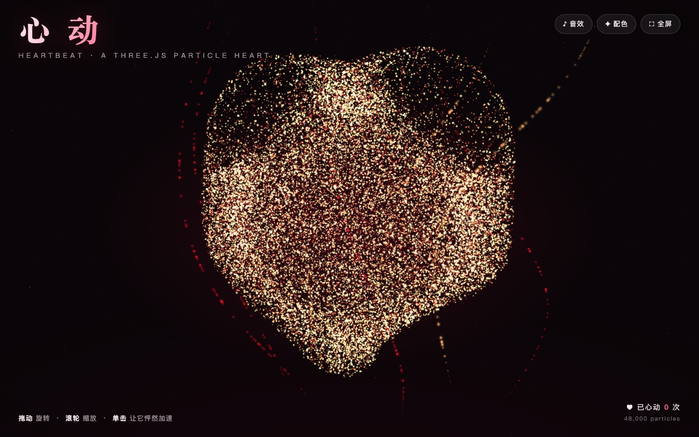

上次把「宇宙的最后一个瞬间」搬进了浏览器([时间的尽头](/2026/11/09/时间的尽头-交互宇宙作品/)),这次做点温软的——一颗**会跳动的粒子爱心**,四万八千颗粒子围成 Taubin 隐式曲面,按真实心跳的「lub-dub」双峰节律收缩、发光、喷火花。单击它,还会怦然加速。



## 立即体验

点开就能玩(推荐 Chrome / Edge / Safari,建议开硬件加速):

<div style="margin: 1.5rem 0; text-align: center;">
  <a href="/heart/" target="_blank" rel="noopener"
     style="display: inline-block; padding: 0.75rem 2rem; border-radius: 999px;
            background: linear-gradient(120deg, #8a1030, #ff5e86); color: #fff0f3;
            text-decoration: none; font-weight: 600; letter-spacing: 0.08em;
            box-shadow: 0 8px 24px rgba(255, 46, 86, .35);">
    ♥ 心动 · 全屏体验
  </a>
</div>

<iframe src="/heart/" title="心动 · Three.js 粒子爱心"
        style="width: 100%; aspect-ratio: 16 / 10; border: 0; border-radius: 12px;
               background: #0a0508; box-shadow: 0 12px 40px rgba(0,0,0,.45);"
        allow="fullscreen" loading="lazy"></iframe>

<small style="opacity:.65;">嵌入框内若卡顿,点上面的按钮全屏打开效果更佳。</small>

## 玩法

| 操作 | 效果 |
| --- | --- |
| 鼠标拖动 / 单指拖动 | 环绕爱心旋转 |
| 滚轮 / 双指捏合 | 拉近拉远 |
| 单击爱心 | 火花迸发 + 进入「心动加速」状态,节律逐渐加快,再慢慢平静下来 |
| ✦ 配色 | 绯红 → 玫瑰金 → 落日 → 极光,四套配色平滑渐变 |
| ♪ 音效 | WebAudio 实时合成的心跳声(默认关闭),lub-dub 两声,随加速变快 |

## 心跳是怎么"跳"的

真实心跳是「lub-dub」两个峰:第一声强,第二声弱,中间有明显的间歇。所以动画包络没有用正弦,而是两个高斯峰的叠加:

```
beat(p) = 1.0·exp(−(p−0.12)²/2w₁²) + 0.52·exp(−(p−0.34)²/2w₂²)
```

静息周期 1.22s,「心动加速」时逐渐压到 0.62s,松手后按指数衰减回到静息。这一个 0~1 的包络值同时驱动:

- **形变**:壳层粒子沿径向膨胀最多 10.5%,内核 5.5% —— 血涌向表面的感觉;
- **发光**:峰值时壳层高光从绛红泛出暖金(加色混合叠出来的);
- **火花**:相位跨过主搏峰的瞬间,从心壳随机粒子处喷出几十颗火花,受重力与空气阻力;
- **屏幕辉光**:CSS 径向渐变层透明度 + 缩放跟着脉动,零成本伪 bloom。

## 四万八千颗粒子是怎么组织的

心形没有用模型文件,而是现场采样 **Taubin 隐式曲面**:

```
(x² + 9/4·y² + z² − 1)³ − x²·z³ − 9/80·y²·z³ = 0
```

在包围盒内随机撒点,`|f| < 0.05` 的落在壳层(占 74%,亮、大、会高光),`f < 0` 的按 8.5% 概率留作内核(暗、小、衬底)。固定随机种子,每次加载形态一致。

> 壳层 + 内核的双层结构:壳层粒子接收心跳的膨胀与金色高光,内核负责让爱心「实心」。

每颗粒子自带一个随机数,在 vertex shader 里做三件事:微颤(各自相位轻呼吸)、闪烁(1.8~6Hz 随机频率)、尺寸抖动。所有动画都发生在 GPU,JS 每帧只更新十来个 uniform 和火花池的 TypedArray。

## 两个偷懒但有效的视觉技巧

1. **没有上 EffectComposer 的 UnrealBloom**:后处理链在小窗 iframe 里开销不小。改用「加色混合粒子 + 屏幕空间 CSS 辉光层」两层叠加,心跳时透明度脉动——视觉上足够"发光",成本几乎为零。
2. **上升余烬完全程序化**:每颗粒子的位置不用 CPU 算,直接在 vertex shader 里用 `fract(time·speed+seed)` 沿螺旋线上升、渐显渐隐,连顶点缓冲都不用更新。

## 与「时间的尽头」的差别

| | 时间的尽头 | 心动 |
| --- | --- | --- |
| 构建 | Vite 打包,three 按需分 chunk | 无构建,three.module.min.js 自托管直引 |
| 粒子数 | ~30 万 | 4.8 万(桌面)/ 2.6 万(移动) |
| 核心工作量 | 纪元状态机 + 镜头穿越 | 隐式曲面采样 + 心跳包络 |
| 主题色 | 冷(蓝紫金) | 暖(绯红玫瑰金) |

一个是冷寂的终局,一个是滚烫的起点——正好是一对。

> 源码在博客仓库 `source/heart/` 目录:index.html(骨架)+ heart.js(约 500 行)+ 自托管 three.js(core + module 两个文件),和站点一样零依赖、零构建。
