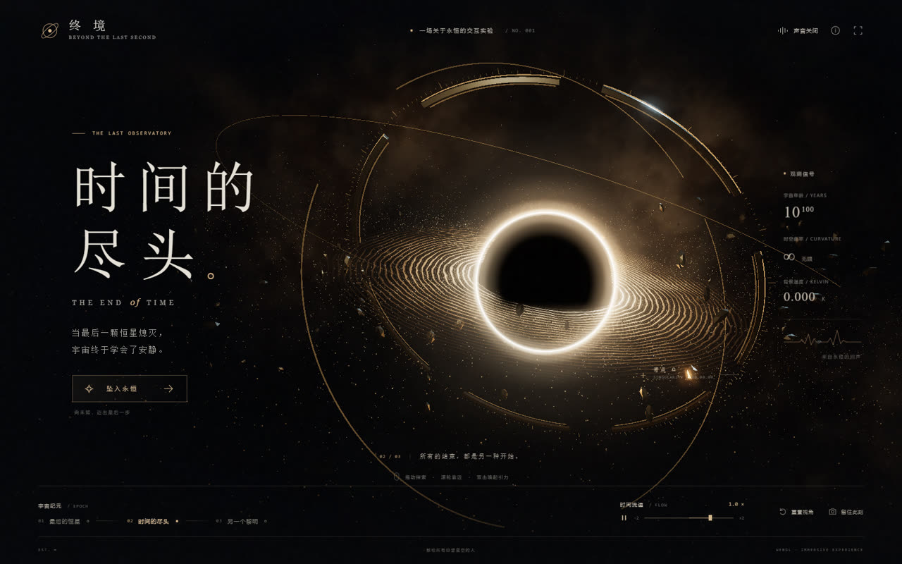
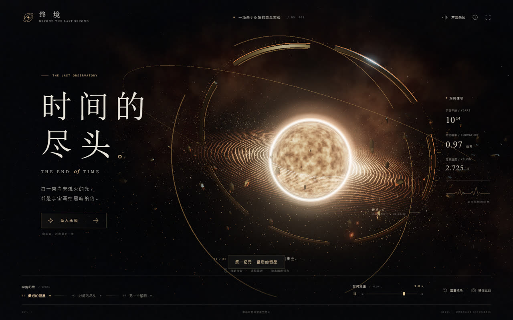
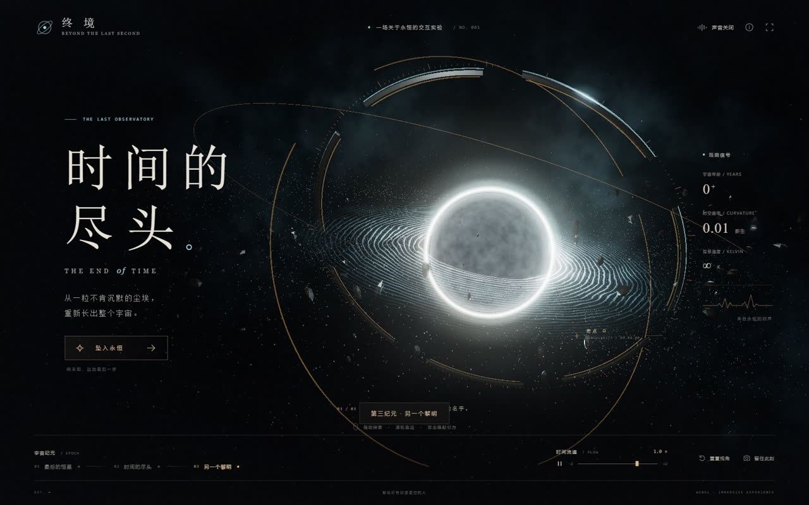
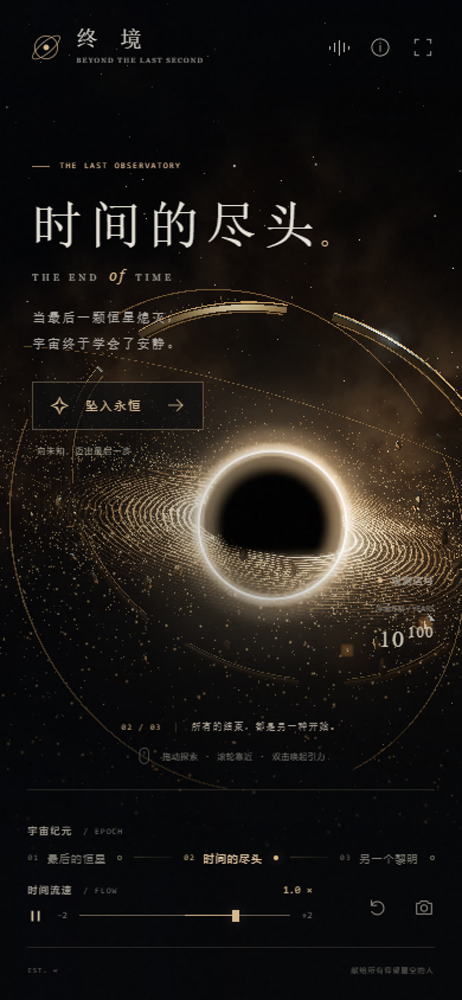

你是末日观测站的最后一位观测者。

奇点在你面前缓慢呼吸，吸积盘的光被引力拧成细环；再往前，时间本身开始干涸。这件作品把"宇宙的最后一个瞬间"做成了一个可以拖动、缩放、切纪元的实时场景——不是视频，不是序列帧，而是在浏览器里跑的 GLSL 与粒子。

## 立即体验

不用装任何东西，点开就能玩（推荐 Chrome / Edge，建议开硬件加速；声音默认关闭，点右上角按钮开启，戴耳机效果更好）：

  <a href="/end-of-time/" target="_blank" rel="noopener"
     style="display: inline-block; padding: 0.75rem 2rem; border-radius: 999px;
            background: linear-gradient(120deg, #1b2a4a, #3a2a5a); color: #f4e8c8;
            text-decoration: none; font-weight: 600; letter-spacing: 0.05em;
            box-shadow: 0 8px 24px rgba(0,0,0,.35);">
    ✦ 进入观测站 · 全屏体验
  </a>

<iframe src="/end-of-time/" title="时间的尽头 · 交互宇宙作品"
        style="width: 100%; aspect-ratio: 16 / 10; border: 0; border-radius: 12px;
               background: #05060a; box-shadow: 0 12px 40px rgba(0,0,0,.45);"
        allow="fullscreen; autoplay" loading="lazy"></iframe>

<small style="opacity:.65;">若嵌入框内卡顿，请点上面的按钮全屏打开（WebGL 在小窗里会降分辨率）。</small>

## 三个纪元

一件作品里塞了三段时间：**最后的恒星**、**时间的尽头**、**另一个黎明**。底部按钮或按 `1` / `2` / `3` 切换，色调、星体状态与观测数据会一起变。

::: box

第一纪元「最后的恒星」——吸积盘还在稳定燃烧，观测站读数正常。
:::

::: box

第三纪元「另一个黎明」——冷色新生，光度曲线重新抬头。
:::

最值得一提的是「坠入永恒」：镜头会真的进入奇点，穿越到下一纪元，再从另一侧回到观测站。这五秒的旅程是整个交互里最难调的部分。

## 玩法

| 操作 | 效果 |
| --- | --- |
| 鼠标左键拖动 / 单指拖动 | 自由环绕奇点 |
| 滚轮 / 双指缩放 | 靠近或远离 |
| 双击画布 / `G` | 释放引力涟漪 |
| 坠入永恒 | 进入奇点，穿越到下一纪元 |
| 底部纪元按钮 / `1` `2` `3` | 切换三个纪元 |
| 时间滑块 | −2 倍到 +2 倍流速，负值让动画真正倒流 |
| 暂停按钮 / `空格` | 冻结或继续时间 |
| `R` / 重置视角 | 平滑回到初始位置 |
| `H` | 隐藏 / 恢复界面 |
| `F` / 全屏按钮 | 进入 / 退出全屏 |
| 留住此刻 | 下载不含界面的宇宙 PNG 原图 |

系统启用「减少动态效果」时，初始时间会自动冻结，由你自己决定什么时候开始。

手机竖屏、横屏与 360px 窄屏都做了单独排版，触控同样可以切纪元、暂停与拖动。

## 技术实现

没有图片素材、没有外部字体、没有模型文件、没有音频文件——所有画面都是算出来的：

- **实时 GLSL 噪声星云**，配合 25,700 个 GPU 星尘与恒星粒子
- **程序化吸积盘、光子环、事件视界对比保护**，以及屏幕空间引力偏折
- **分段挤出的金属天文仪**，240 个实例化刻度、180 块旋转碎片
- **多级辉光 + 电影色调映射 + 程序化颗粒与暗角**
- **阻尼环绕镜头、引力脉冲、五秒穿越旅程、平滑纪元变色**
- **Web Audio 实时合成五声部低频环境音**，慢速调制与引力声效
- 低帧率时自动降低渲染分辨率，桌面、手机竖屏和横屏分别排版

实测（1600 × 1000，无头 Chrome，WebGL 2）：**57 FPS**，每帧 48 次绘制、37 个几何体，脚本 / GLSL / 资源加载错误 **0**，运行时远程请求 **0**。32 项浏览器验收全部通过，包括真实渲染、拖动缩放、时间冻结与倒流、三纪元切换、声音启停、全屏、PNG 下载、完整穿越、键盘操作与手机触控。

## 一点说明

作品是艺术想象：宇宙年龄、温度与曲率属于叙事设定，引力透镜效果是视觉近似，不是广义相对论的数值模拟。

但对"时间的尽头"这件事，我确实想表达一个态度——**它不该是一个静止的句号，而是一段可以走进去的路**。所以我把终点做成了入口。

<!-- 想自己跑一份？构建方式：Vite + Three.js，产物为纯静态文件，任意静态服务器都能托管。 -->
