第一批是十种语言（[提示词全记录](/2026/11/09/时间的尽头-提示词全记录/)），第二批是三十一种。

同一个主题、同一段主题描述，只换风格层。这一轮我把「还能怎么画」整理成了六组：东方工艺、艺术史、平面设计、数字材质、材料实验，最后一组不换风格、只换画布尺寸。三十一张图全部串行生成：单张生成时间合计 **16 分钟**，加上下载与落盘，端到端约 **20 分钟**，模型 `gpt-image-2.6`，三十一张一次通过、零失败。

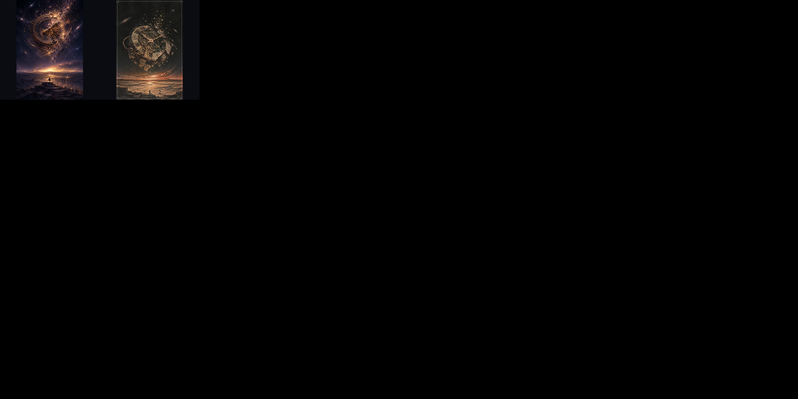

## 〇、还是那两段式

主题段一字未改，和第一批完全相同——因为**可比性来自不变量**：

```
主题《时间的尽头》：宇宙最后时刻。一座半溶解的巨型天文钟悬浮在虚空中，齿轮与指针崩解成飞散的颗粒；
钟下方是一条干涸的时间之河，河床龟裂，最后一点液态光正在蒸发；远处星系坍缩成一条地平线，
星辰逐颗熄灭只剩余晖；画面底部一个极小的人影站在断裂的石阶上，背向镜头，仰望消失的光。
```

每一张图都是 **`风格层 + 主题段`** 的简单拼接。下面三十一段就是三十一个风格层，原文照贴，可直接取用。

## ① 东方工艺 

和第一批的水墨、浮世绘接上，这一组是同一脉络里材质差异最大的四种手艺，加上一路金箔。

### 11 · 工笔重彩

细线勾勒＋矿物色罩染，天文钟成了一幅精密到病态的界画。

```
中国工笔重彩风格（gongbi zhongcai, fine-line heavy color）：绢本设色，细如发丝的墨线勾勒后层层罩染，矿物颜料——石青、石绿、朱砂、蛤白、泥金，色彩沉厚而透亮，局部贴金箔；构图为界画式，机械与建筑用界尺画直线，天文钟化为一座精密到病态的楼阁式机关钟，齿轮与斗拱咬合，每一枚铆钉都描了线；崩解处裂成细密的绢丝断口，碎屑如金粉悬浮；时间之河是一道极细的银线河床，河床裂纹用工笔皴法；星系坍缩为一圈晕染的朱砂与石青渐变；人影是画在右下角的一个极小的高士背影。意境华贵而寂灭，全手工描绘质感，无文字、无落款、无水印。
```

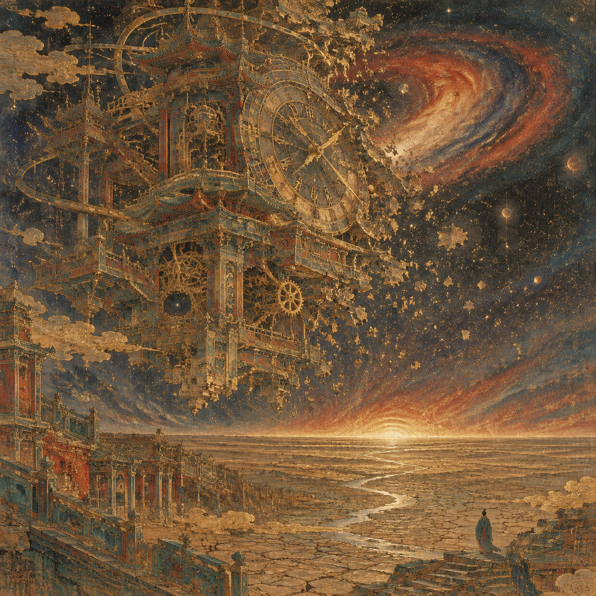

### 12 · 青花瓷

只有钴蓝一色，留白最多；把宇宙坍缩画在瓷板上，反差最大。

```
青花瓷板画风格（blue-and-white porcelain, 元青花/明永乐）：只以钴蓝一色在白瓷釉下绘制，浓淡靠钴料分水（五色青花），釉面有细密开片与橘皮纹，边缘留出瓷胎白；构图像一只梅瓶展开的连续画面，上下有莲瓣纹与缠枝纹边框；天文钟化为青花绘制的宝塔机关钟，齿轮被画成缠枝莲与回纹的变形；崩解处釉面碎裂，露出素胎与针眼；时间之河是一道青花留白的波浪，河床裂纹如冰裂青花；星系坍缩为一圈深蓝散晕（苏麻离青的铁锈斑）；人影是瓷面上的一个极小点景高士。器物级质感，釉光可见，无文字、无印章、无水印。
```

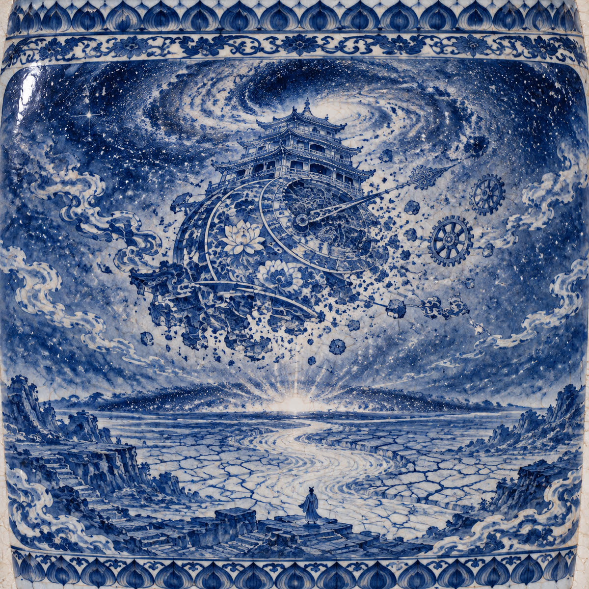

### 13 · 敦煌壁画

土红、石青、石绿加晕染剥落，比埃及壁画更飘、更有风沙感。

```
敦煌莫高窟壁画风格（Dunhuang mural, 唐代经变画）：土红地仗层上以矿物颜料平涂，石青、石绿、土红、藤黄、蛤白，加晕染（凹凸法）与描金；墙面剥落、龟裂、烟熏，局部露出草筋泥层与起甲的颜料片；构图横向分层，上有藻井垂幔与飞天飘带环绕；天文钟化为一座敦煌式的曼荼罗机关，齿轮环如莲花瓣，指针如金刚杵；崩解处颜料成片剥落、金箔飞散；时间之河是土红色带白描水波纹的河床，干涸龟裂；星系坍缩为一圈背光式的火焰纹光晕；人影是壁画中一个极小的供养人侧影，合掌仰望。风沙感、千年剥蚀感，飞天飘带与璎珞点缀，无文字、无水印。
```

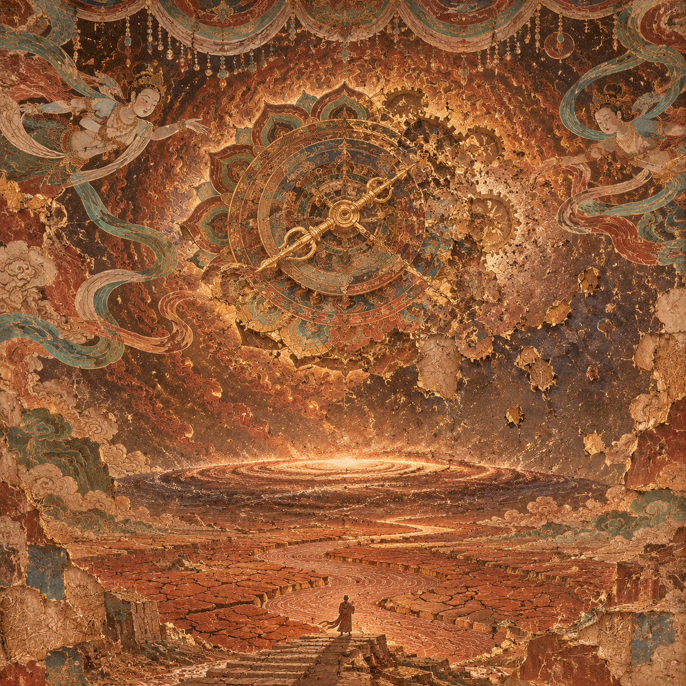

### 14 · 剪纸

单层镂空只有正负形，时间的崩解变成参差的锯齿断口。

```
中国传统剪纸风格（Chinese papercut, 单层红纸镂空）：纯正负形——一张正红色宣纸剪出所有形体，纸面之外全部留白，仅靠镂空线与锯齿纹（锯齿断口）表现明暗与结构；纹样用月牙纹、云纹、水波纹、铜钱纹；天文钟化为剪纸灯笼式机关钟，齿轮由锯齿环剪成；崩解处是参差的锯齿断口与散落的纸屑颗粒；时间之河是镂空的水波纹条带；星系坍缩为一圈放射状月牙纹；人影是剪纸小人对折剪出的对称背影。单色红，平面化，对比强烈，手工剪纸的毛边与纤维感，无文字、无水印。
```

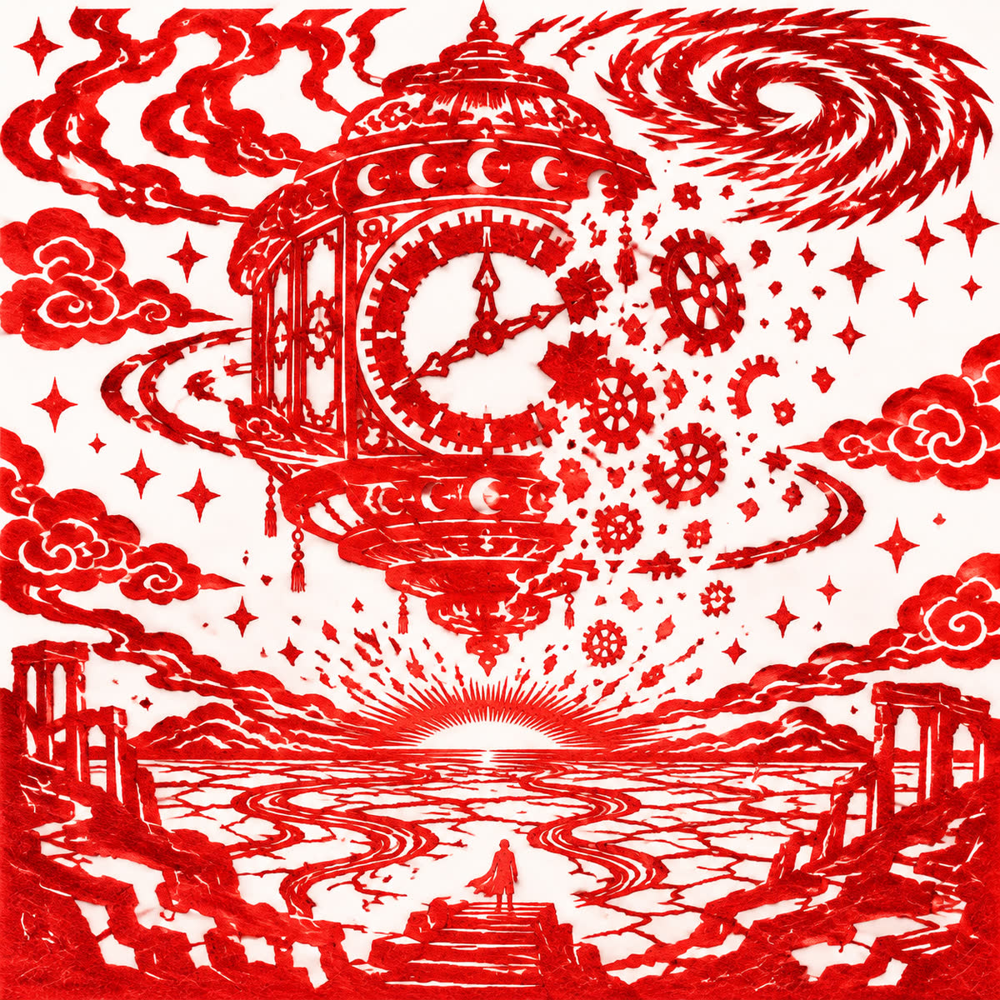

### 15 · 琳派金箔屏风

金箔底＋极简构图，河与钟只剩几根线，贵气又空旷。

```
日本琳派屏风画风格（Rinpa school, 尾形光琳/俵屋宗达）：六曲一双的金箔屏风底，金箔拼接缝与岁月氧化斑可见；构图极简到近乎空，只用几根墨线与几片色块，主体偏置一侧，大片金地留白；配色为金地＋墨黑＋群青＋朱红＋萌黄；天文钟只画成半个金色轮廓与几道刻线，像被屏风边缘裁掉；崩解处是几片飘落的银箔与金箔碎屑；时间之河用一道极细的群青色流水线加两笔浪纹（光琳波）；星系坍缩为一圈朱红晕染的日轮；人影是屏风角上一个墨点般的旅人。装饰性、贵气、空旷，金箔反光质感，无文字、无落款、无印章、无水印。
```

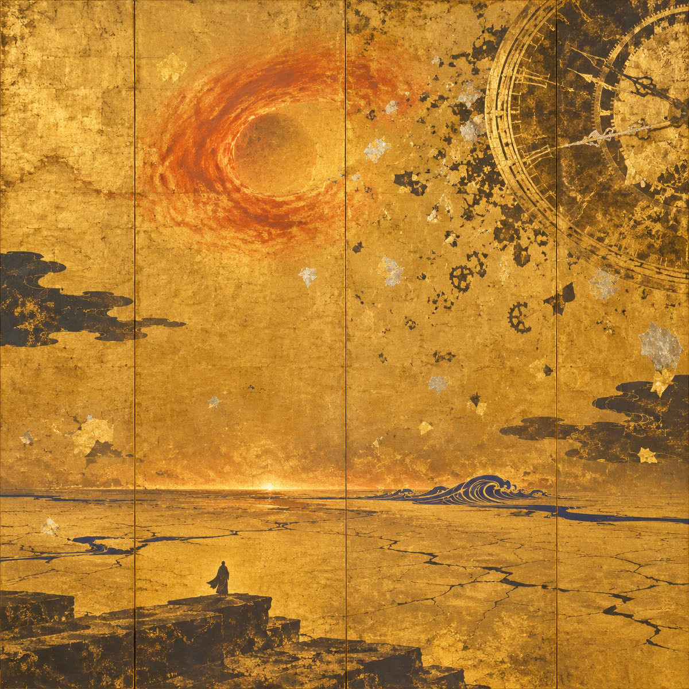

## ② 艺术史 

不是「复古滤镜」，而是把画面强行塞进某种真实存在过的观看制度：透视、镶嵌、仰视、书页、透光、以及梦境。

### 16 · 文艺复兴湿壁画

透视法与壁画裂缝，人影变成了穿长袍的理想比例。

```
意大利文艺复兴湿壁画风格（buon fresco, 马萨乔/皮耶罗·德拉·弗朗切斯卡）：石灰泥壁上的矿物颜料，哑光、粉质、色阶被岁月洗淡；严格的线性透视与空气透视，人物比例理想化、衣褶成块；墙面有裂缝、局部起甲脱落露出底灰，边缘有烟熏与雨痕；天文钟化为一座透视精准的城邦塔钟，齿轮如建筑构件与拱券；崩解处露出石膏底层与红褐勾稿线（sinopia）；时间之河是透视网格里的一条干涸水渠，河床裂纹顺着灭点汇聚；星系坍缩成一道地平线上的金色余晖；人影是穿长袍、比例略小的背影站在断阶上。庄重、平衡、壁画年代感，无文字、无水印。
```

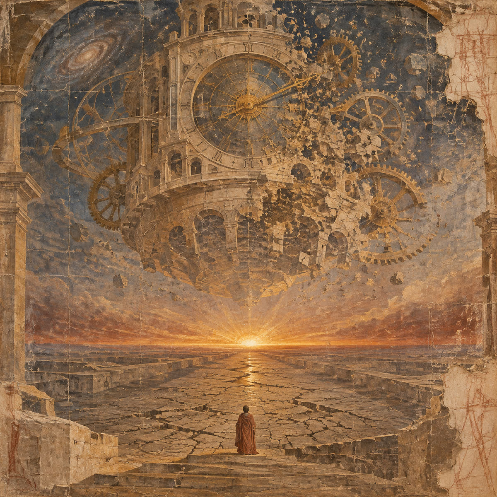

### 17 · 拜占庭马赛克

一切被切成几毫米的玻璃方块，反而比写实更震。

```
拜占庭马赛克镶嵌画风格（Byzantine mosaic, 拉文纳圣维塔莱）：整幅画面由 3-5mm 的玻璃与石块镶嵌片（tesserae）拼成，金底镶嵌片朝向略有不匀而产生闪烁；镶嵌缝可见，边缘为不规则阶梯状；配色为金、深蓝、青绿、朱红、石膏白；构图平面化、正面律、等级比例；天文钟化为一座金色的圣像式圆形机械，钟盘如光环，齿轮如镶嵌环带，完全被切割成方块；崩解处镶嵌片一枚枚剥落、悬浮；时间之河是一条蓝色镶嵌片拼出的干涸河床；星系坍缩为一圈金底放射光芒；人影是侧面站立、合掌的极小圣徒剪影。神圣、静穆、手工镶嵌的颗粒闪烁，无文字、无铭文、无水印。
```

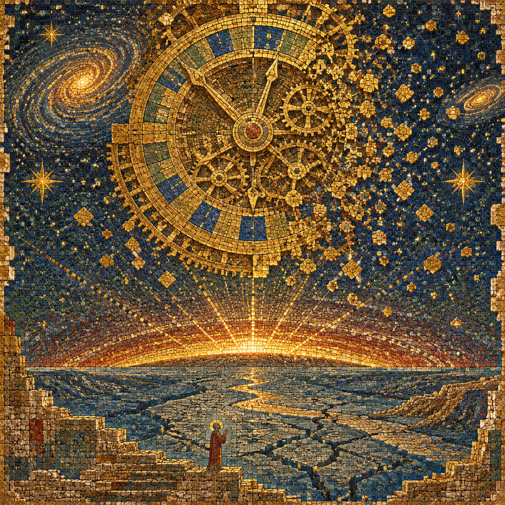

### 18 · 巴洛克天顶画

仰视透视＋旋涡云，天文钟悬在头顶被光劈开。

```
巴洛克天顶画风格（Baroque ceiling fresco, di sotto in su 仰视透视，波佐/提埃波罗）：从下往上的极端仰视透视，人物与机械沿对角线翻滚、被云团托举；四周有错视建筑边框（quadratura）与灰泥藻井；光线从画面顶部慈悲地劈下；配色为暖金、玫瑰、铅灰、深蓝阴影，强烈明暗对比；天文钟悬在头顶正上方，齿轮与指针被透视压扁、向上旋转崩解；时间之河成了倒挂的一道水流，水点向观众落下；星系坍缩为顶部一圈眩目的金光与旋涡云；人影是站在画面最底部边缘的一个极小仰头观者，被光勾出轮廓。宏大、眩晕、天顶画的纵深错觉，无文字、无水印。
```

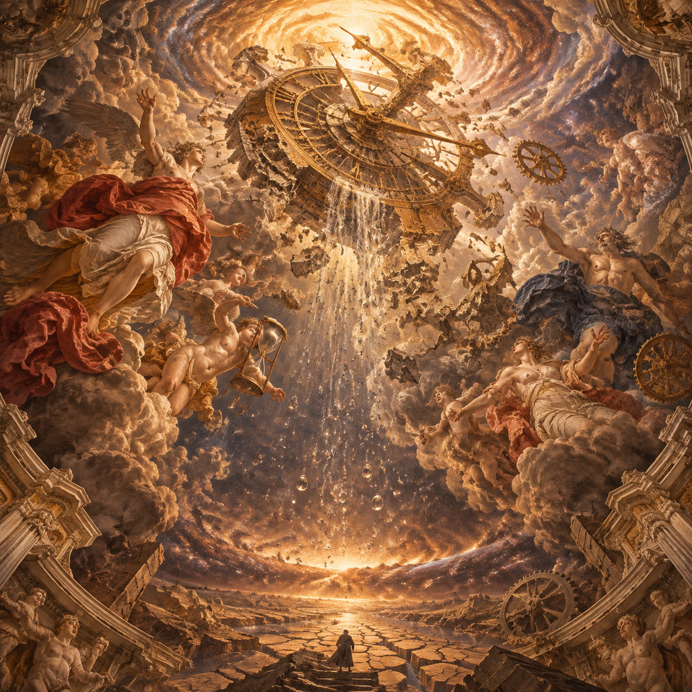

### 19 · 中世纪泥金手抄本

泥金边框＋平面化小人，宇宙缩成一页书页插图。

```
中世纪泥金手抄本插图风格（illuminated manuscript, Book of Hours）：犊皮纸（vellum）质地，奶黄偏暖，纸面有细微起伏与旧渍；画面被泥金边框包裹（金箔底＋红蓝交替的细密花饰），四周有藤蔓卷草与彩色首字母装饰边框；人物与物体平面化、略带稚拙，比例象征化；配色为群青（lapis ultramarine）、朱红、金箔、铜绿、白铅；天文钟被画成一页书中的圆形宇宙图，齿轮变成边框上的花饰；崩解处是金箔剥落的小片与墨线断续；时间之河是羊皮纸上一道蓝线水纹；星系坍缩为一圈金色的星芒孔洞；人影是书页角落一个极小的修士剪影，捧书仰望。虔诚、精巧、手抄本的粗糙与温度，画面中不含可读文字，无文字、无水印。
```

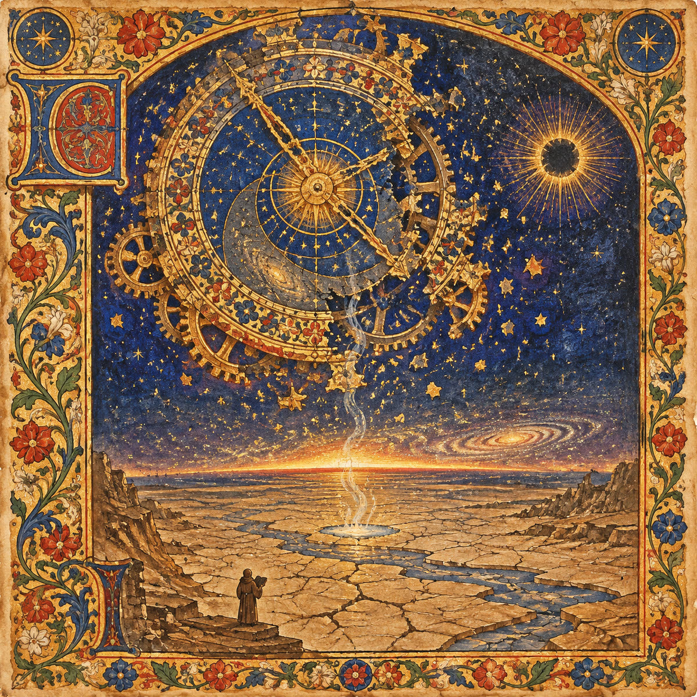

### 20 · 哥特彩窗

铅条分割＋透光玻璃，星辰成了穿透玻璃的光斑。

```
哥特式彩色玻璃窗风格（Gothic stained glass, 沙特尔/圣礼拜堂）：整幅为一块尖拱窗，黑色铅条（lead came）分割出所有线条与色块，玻璃半透明、内部有气泡与厚薄不匀的波纹，逆光透射；配色为钴蓝底＋猩红＋祖母绿＋琥珀金＋紫罗兰；平面化、分格叙事、玫瑰窗式的圆形分割；天文钟化为一块玫瑰窗式的巨型圆形机械，齿轮与指针成为铅条分割的几何图形；崩解处玻璃碎裂，铅条弯折，碎片向光悬浮；时间之河是窗下部的波浪形蓝玻璃条带；星系坍缩为玫瑰窗中心一团金色光核；人影是窗格底部一个极小的侧身修士剪影。神圣的光、饱和透光的玻璃、铅条的硬线，无文字、无水印。
```

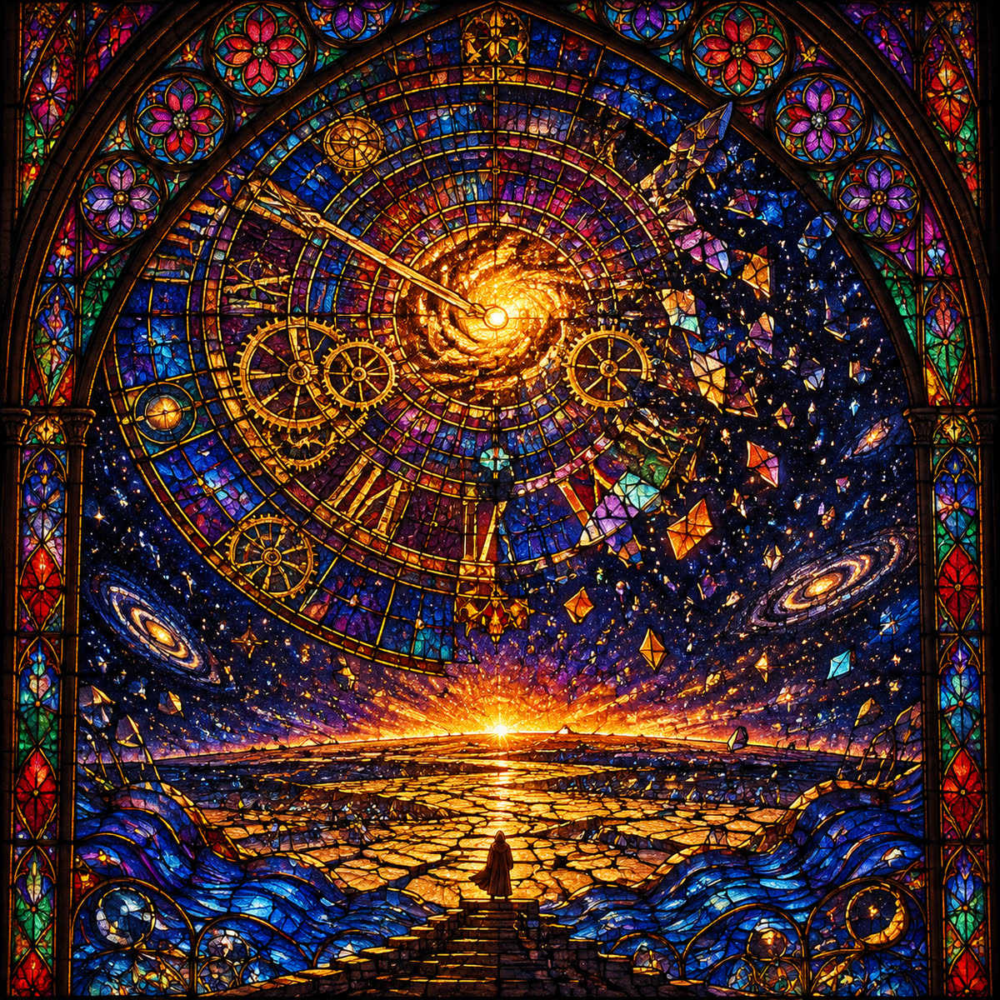

### 21 · 超现实主义

本来就半溶解的钟，被达利式地彻底拧软。

```
超现实主义油画风格（surrealism, Dalí / Magritte）：精确写实的笔法描绘荒诞之物，空旷的海岸地平线与极浅的景深；物体柔软融化、被无限拉伸、违背重力地悬吊；冷灰蓝的天空＋暖赭石地面，长投影与纯静的空气；天文钟被彻底拧软，钟盘像一块融化的面团从齿轮上垂落，指针软成一根丝；时间之河是一条挂在半空的液态丝带，河床裂纹在沙地上延伸；星系坍缩为一枚钉在天幕上的金属纽扣式光点；人影是一个极小的人，影子拉得极长，且影子朝向与光相反。冷静、精确、令人不安，博物馆级油画质感，无文字、无签名、无水印。
```

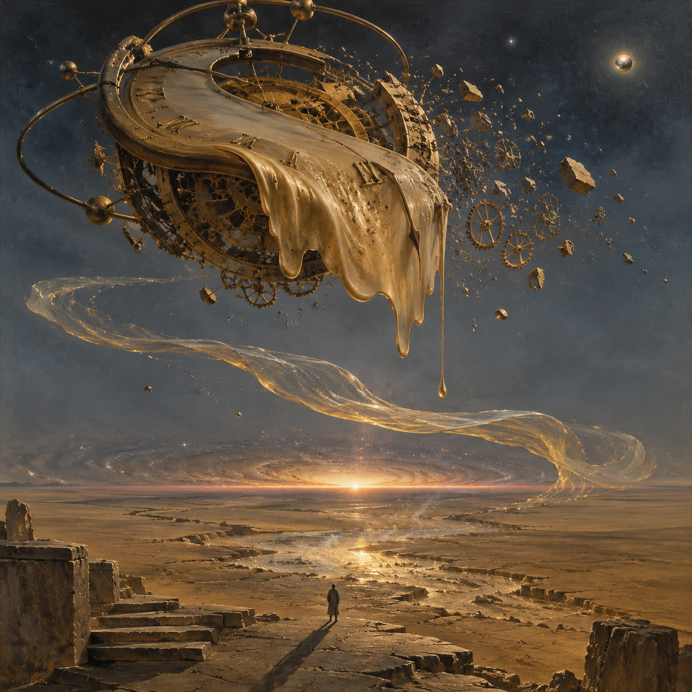

## ③ 平面设计 

把宇宙当成一个需要被排版的对象。这一组的成败全在「删」——留下的元素越少，末日越冷静。

### 22 · Art Deco

对称几何＋金色放射线，仪式感与末日天然同构。

```
Art Deco 装饰艺术风格（1925 巴黎世博会气质）：严格的对称与金字塔式构图，几何化的放射线、阶梯形、扇形与流线曲线；金属金、黑、象牙白、深祖母绿的配色，局部箔金与漆面反光；天文钟化为一座对称的放射状几何装置，齿轮被抽象成同心阶梯环与三角齿；崩解处是规则的几何碎片沿对称轴飞散；时间之河是三道平行的流线曲线与阶梯河床；星系坍缩为一圈金色放射光芒；人影是一个程式化的黑色剪影，站在对称轴的正中。海报级的装饰感、圆柱与阶梯的层次，无文字、无水印。
```

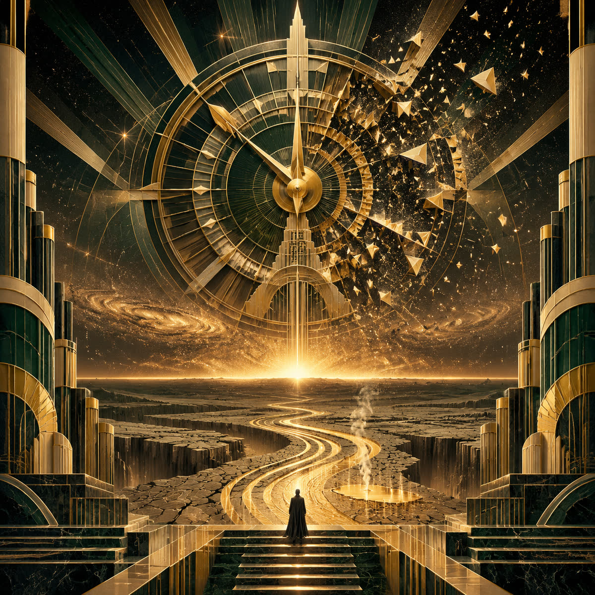

### 23 · 瑞士国际主义

网格＋无衬线＋大留白，把终结做成一张冷静的海报。

```
瑞士国际主义平面设计风格（Swiss Style / International Typographic Style, Josef Müller-Brockmann）：极简、不对称网格构图，几何形，大面积留白与单一焦点；配色为黑、白、信号红＋一个灰色阶；高对比黑白主体，配纯色几何色块；天文钟化为一个被网格裁切的巨大圆形刻度盘与几道直线，只剩最必要的结构信息；崩解处是几个精确的方块沿网格线错位；时间之河是一条极细的灰线；星系坍缩为一个正圆与一道水平线；人影是一个极小的黑色人形，位于网格交叉点上。理性、克制、印刷品质感，画面中不出现任何可读文字，无文字、无水印。
```

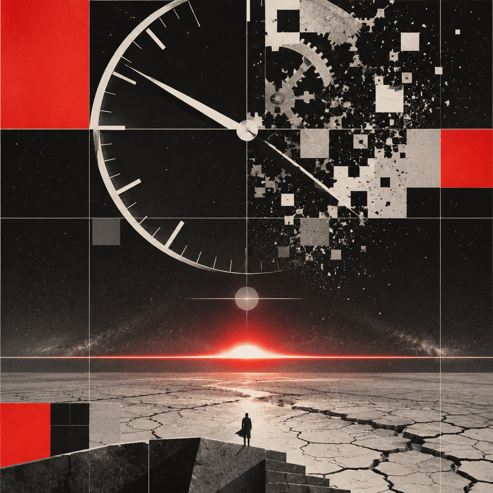

### 24 · 1970s 太空歌剧平装书封面

高饱和喷绘＋硬边框，复古科幻感直接拉满。

```
1970 年代太空歌剧平装书封面风格（1970s sci-fi paperback cover art, Chris Foss / John Berkey 气质）：高饱和喷绘（airbrush）质感，硬边圆角黑色画框，构图上方留出书名位置的大片深色天空，下方是三段式喷绘色带；配色为洋红、橙金、青绿、深紫，喷笔渐变与细密星尘；天文钟化为一座喷绘光泽的巨大环形空间站式钟，齿轮是发光的舱段与桁架；崩解处是喷绘的碎片轨迹与光弧；时间之河是一条悬在星云中的干涸运河平台；星系坍缩为一道橙金色的喷绘地平线；人影是封面下方一个极小的人，被喷绘光晕包围。复古廉价纸浆书的油墨味与颗粒，无文字、无书名、无水印。
```

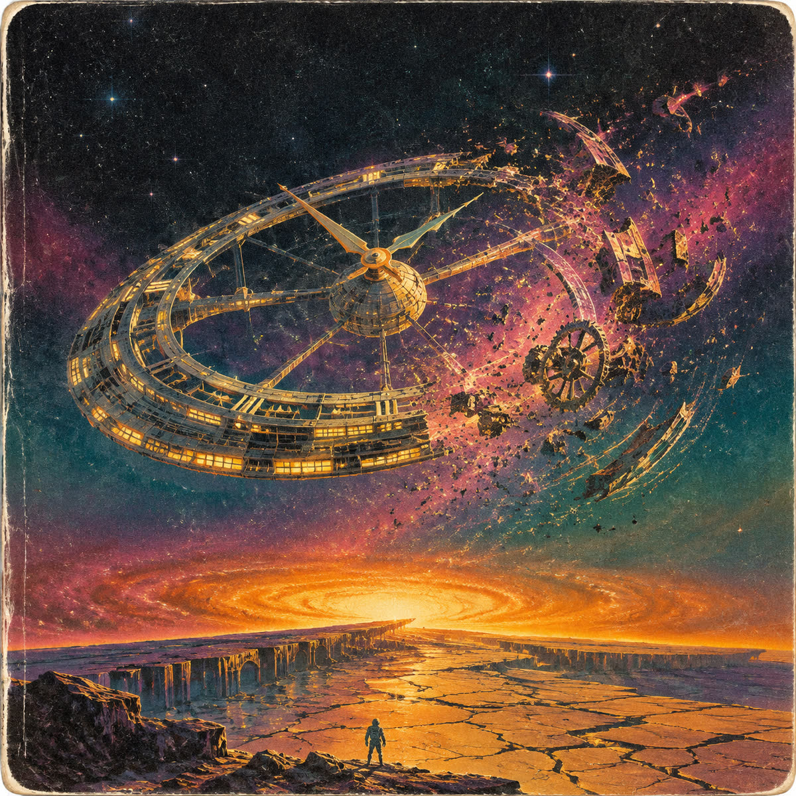

### 25 · 苏联构成主义

红黑对角＋粗体几何，把「终结」压成一句口号。

```
苏联构成主义海报风格（Russian Constructivism, 罗琴科/李西茨基）：红、黑、米白三色，对角线主导的强烈动势，粗重的几何块面与照相蒙太奇拼贴；网点印刷与粗糙纸张纹理，套色轻微错位；天文钟化为由圆、三角、矩形构成的机械符号，齿轮变成齿轮状的红色剪影；崩解处是方块与斜线沿对角线飞出；时间之河是一条粗黑斜带；星系坍缩为一个巨大的正圆（红与黑各半）；人影是一个照相蒙太奇的工人剪影，尺度极小，站在斜线尽头。宣传画的力量感，印刷错版感，画面中不出现可读文字，无文字、无水印。
```

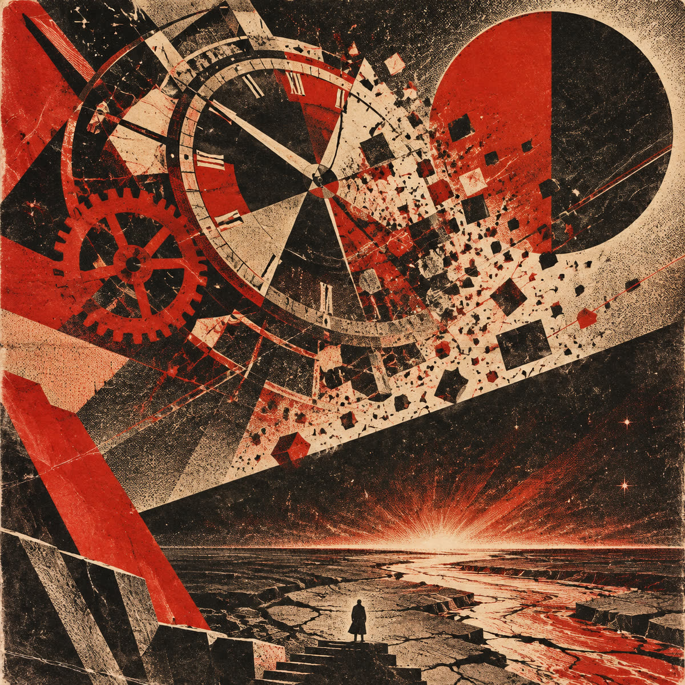

### 26 · 蓝图 / CAD 图纸

白线蓝底＋标注线，天文钟成了一份被废弃的工程图。

```
工程蓝图风格（blueprint / CAD technical drawing）：深普鲁士蓝底，白色细线与半透明辅助线，尺寸标注线、剖面线与箭头、网格坐标与定位十字；多层线宽（粗实线轮廓、细虚线隐藏线）、局部放大圈与引出线；轻微晒图纸的纸基纹理与折痕；天文钟被画成一份被废弃的机械总装图，齿轮以正投影与剖视呈现，指针单独作为一个零件图；崩解处以虚线表示拆解顺序与爆炸图位移；时间之河是河床断面的等高线图；星系坍缩是几圈同心圆与标注点；人影是一个比例尺人形符号，站在图纸右下角。冷静、精密、纸感，标注不含可读文字，无文字、无水印。
```

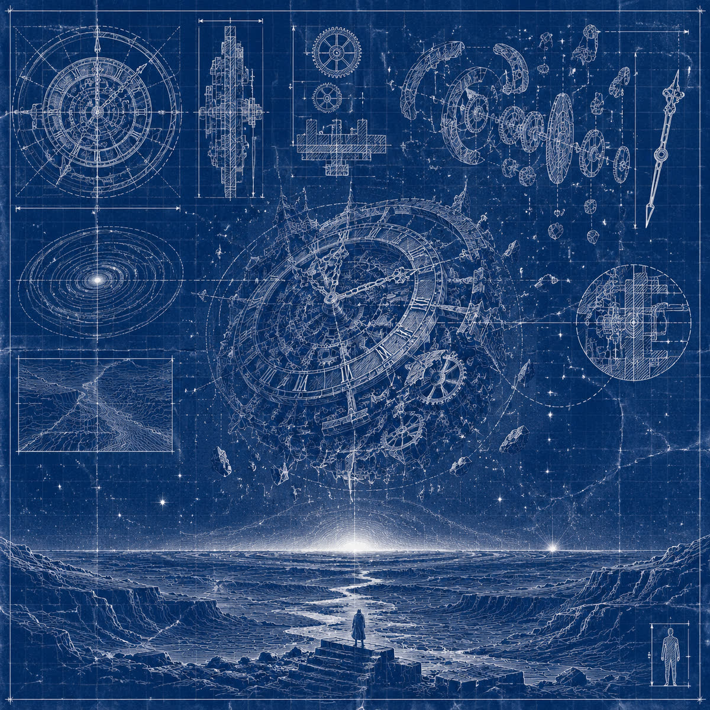

### 27 · 波普艺术

网点＋平涂高饱和，末日也能很轻佻。

```
波普艺术风格（Pop Art, 利希滕斯坦/沃霍尔）：本戴点（Ben-Day dots）网点＋平涂高饱和撞色，粗黑轮廓线，印刷套色轻微错位；配色为荧光粉、柠檬黄、天蓝、正红、墨黑；光洁的丝网印刷质感，重复与裁切的构图；天文钟化为一个巨大的卡通化机械装置，齿轮是塑料感的高饱和圆盘，指针粗黑；崩解处是漂浮的网点与色块碎片；时间之河是一条粉蓝色的干涸河床，裂纹是粗黑线；星系坍缩为一个带描边的圆形半调渐变；人影是一个黑边平涂的漫画式剪影，尺度很小。轻佻、量产感、印刷网点肉眼可见，无文字、无对话气泡、无水印。
```

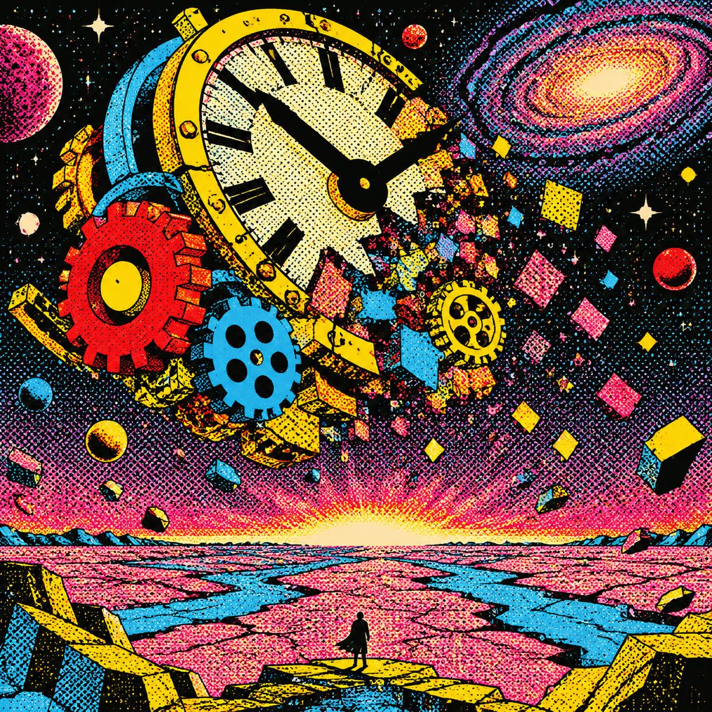

## ④ 数字材质 

换成三维世界的四种「材料约定」：面、体素、黏土、线。同一句话，量感完全不同。

### 28 · Low-poly 低多边形

三角面＋平面着色，星云成了水晶碎面。

```
Low-poly 低多边形 3D 渲染风格（flat-shaded low-poly）：一切由清晰可见的三角面构成，每个面单一平涂色，无平滑过渡，边缘硬朗；配色为深空蓝紫、青绿、玫红的渐层顶点色，环境光遮蔽柔和；天文钟化为一个由数百三角面构成的环形机械，齿轮是多边形齿；崩解处三角面一片片脱落、漂浮、体积缩小；时间之河是低多边形的干裂河床与几片水晶状水面；星系坍缩为一条由三角形拼成的地平线；人影是一个约十二个面的低模小人。干净、当代、游戏美术的几何美感，无文字、无水印。
```

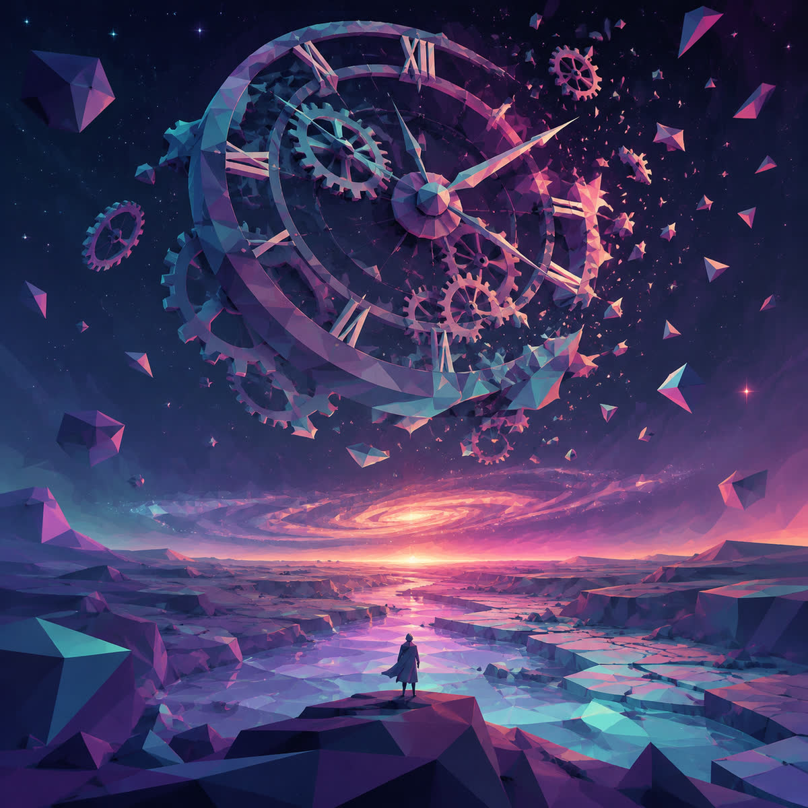

### 29 · Voxel 体素

一切由立方体组成，量感强得离谱。

```
体素 3D 渲染风格（voxel art, MagicaVoxel 气质）：世界完全由大小一致的立方体构成，可见的立方体棱线与轻微的环境光亮边；配色为暗紫、深蓝、琥珀、青绿，靠立方体明度变化塑形；天文钟化为一个巨大的体素环形机械，齿轮是阶梯状体素齿；崩解处体素一块块脱落、悬浮、发光；时间之河是逐层下沉的体素河床，裂纹是挖空的体素沟；星系坍缩为体素颗粒组成的水平线；人影是一个八体素高的小人。量感强、可爱又荒凉，等距视角，无文字、无水印。
```

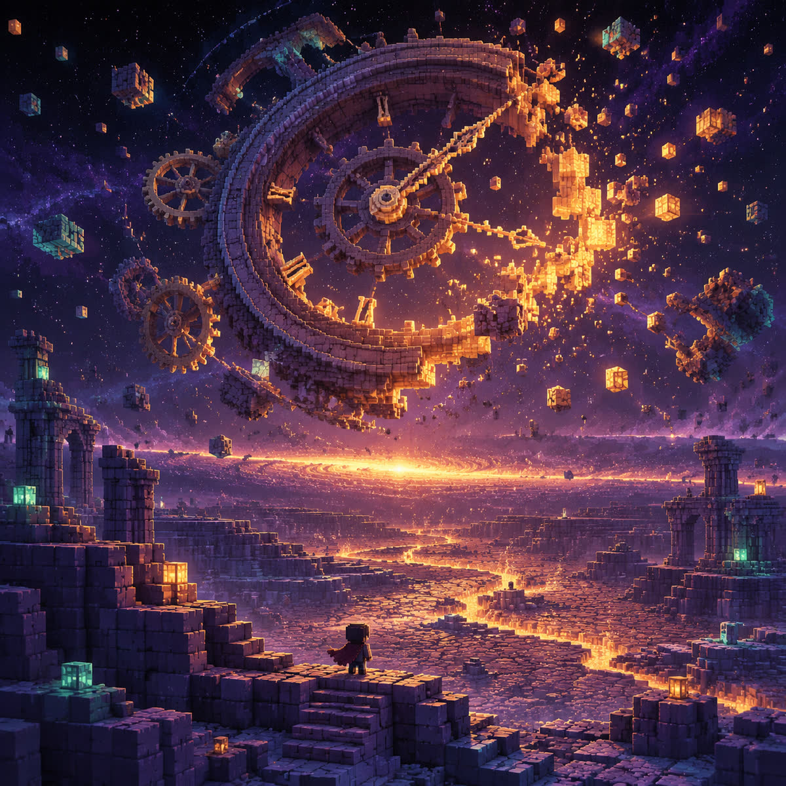

### 30 · 3D 粘土渲染

黏土质感＋柔光，把宇宙做成一件手工玩具，反差最狠。

```
3D 粘土渲染风格（clay render, soft matte material）：像橡皮泥／陶土手捏的造型，指痕与轻微压凹可见，表面完全哑光无高光，柔和的天地环境光与柔软的接触阴影；配色为柔和的粉灰、米白、雾蓝、赭土，低饱和；天文钟化为一坨被捏出来的粘土钟，齿轮像饼干模具压出的圆齿，指针软得下垂；崩解处粘土块圆润地断裂、掉屑；时间之河是一条被手指抹平的粘土河床，裂纹是被划开的软泥口；星系坍缩为一颗粘土圆球上的一道光；人影是一个圆头圆手的粘土小人，极小。可触摸的手工感，宏大宇宙×玩具质感的极强反差，无文字、无水印。
```

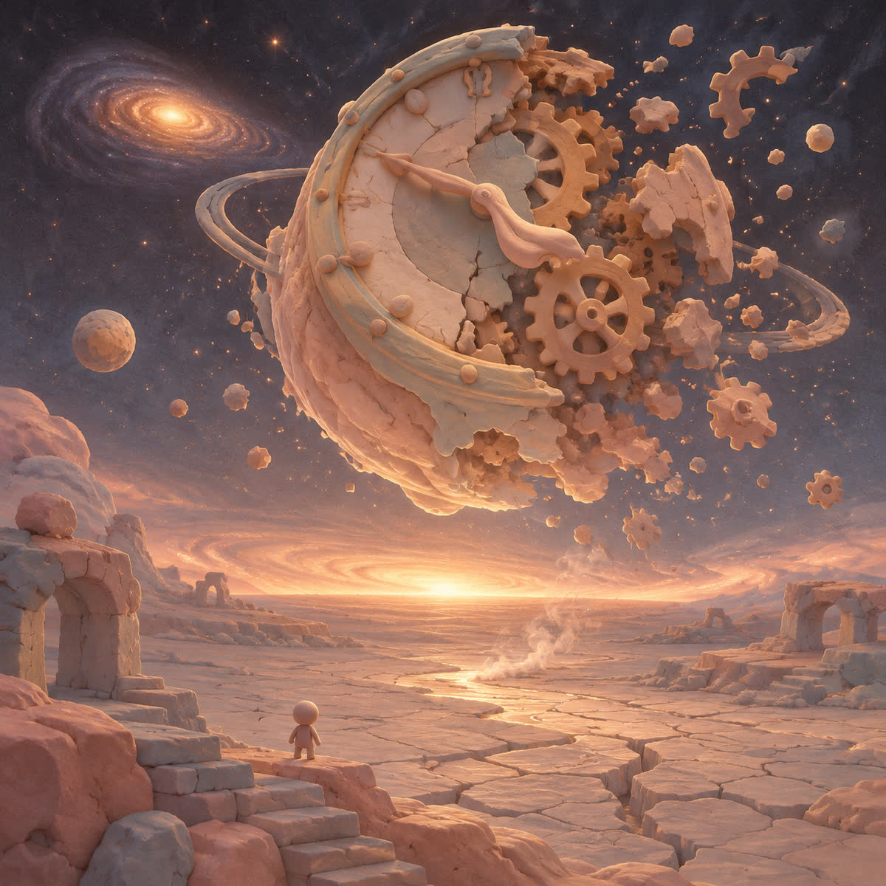

### 31 · 线框 Wireframe

只有线、没有面，像一份永远没做完的模型。

```
线框渲染风格（wireframe / technical 3D line art）：深黑背景上只有发光的细线，没有面、没有实体，透视线可见（被遮挡的背面线以更低亮度呈现）；配色为青色主线＋品红辅助线＋白色顶点；略有余晖式辉光（bloom）与轻微扫描线；天文钟化为纯粹的线框环形机械，齿轮是同心圆与辐射线；崩解处线段断开、顶点飘散、部分线框悬空；时间之河是一条由折线构成的干涸河床网格；星系坍缩为一组向地平线收束的透视网格线；人影是一个由二十余条线构成的小人轮廓。未完成模型的冷感，无文字、无水印。
```

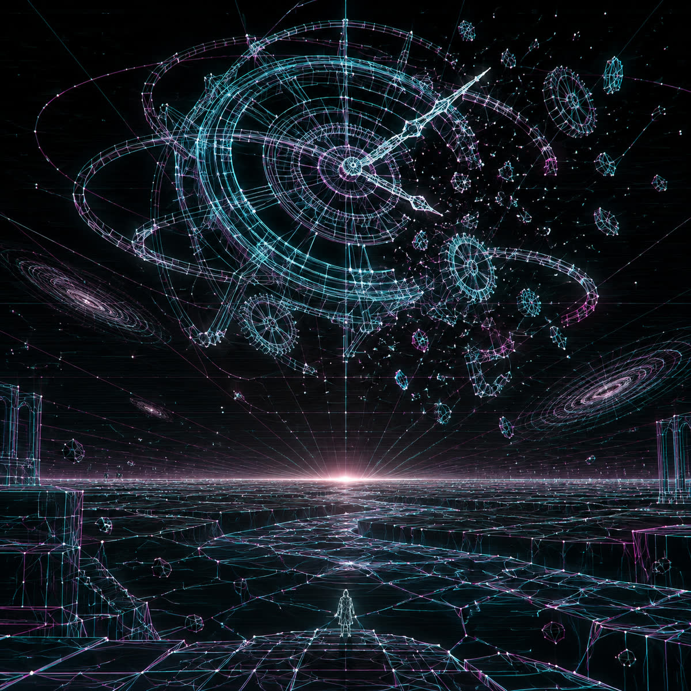

### 32 · 点云 / ASCII

用字符亮度重建画面，最接近「数据正在消失」。

```
点云与 ASCII 数据可视化风格（point cloud + ASCII art hybrid）：画面由密集的等宽字符（# % @ . : * =）在深黑底上排列而成，字符亮度随形体明暗变化，远处字符更稀疏；叠加一层稀疏的发光点云，每个点是一个小十字；带 CRT 扫描线与轻微琥珀单色荧光；天文钟由字符明暗拼出巨大的环形机械，齿轮边缘的字符更密；崩解处字符散开、点云剥离、部分区域只剩空白；时间之河是一行行渐淡的字符与断裂的点线；星系坍缩为一条由极小字符构成的地平线；人影是一个由十二个字符组成的微小剪影。像数据正在消失，机器视角，除抽象字符纹理外无可读文字，无水印。
```

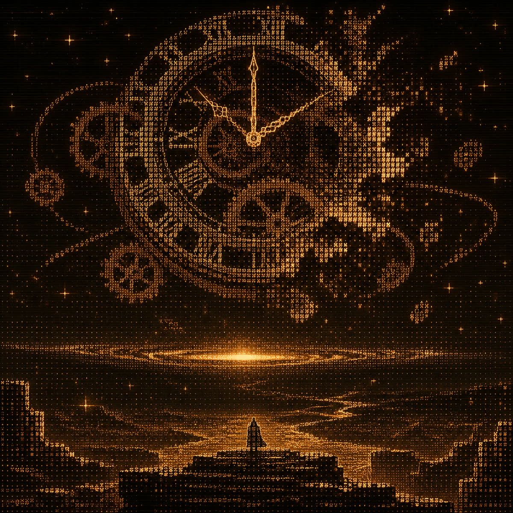

## ⑤ 材料实验 

最不客气的一组：把宏大叙事交给乐高、折纸、沙、玻璃底片、棉线和刻刀。反差就是内容。

### 33 · 乐高积木

崩解的齿轮变成散落一地的积木，荒诞又可爱。

```
乐高积木拼搭摄影风格（LEGO brick diorama, macro photography）：一切由带凸点的塑料积木块拼成，颗粒边缘有轻微注塑分模线与塑料光泽，缝隙可见；微距摄影的浅景深与柔光，桌面上的真实阴影；配色为深蓝、透明橙、透明青、沙色、金属银；天文钟化为一座积木拼的巨钟，齿轮是圆盘零件与齿状斜面砖；崩解处积木块一块块崩落、悬空、散在地上；时间之河是一条深蓝积木底板拼出的干涸河床，裂纹是错位的砖缝；星系坍缩为透明橙色积木拼的地平线，内透光；人影是一个只有四块积木的小人。荒诞又可爱，宏观宇宙被做成桌面模型，无文字、无商标、无水印。
```

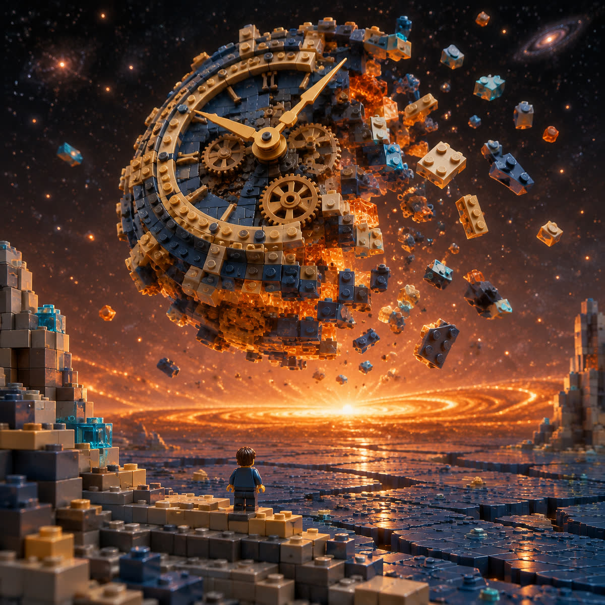

### 34 · 折纸

折痕即结构，光只出现在斜面的交界处。

```
折纸艺术风格（origami, 单张和纸折叠，无裁剪）：所有形体由折痕与折面构成，纸的厚度、纤维与轻微透光可见，折痕是唯一的线条；配色为深靛蓝＋米白＋朱红＋金箔和纸，纸面有云纹纤维；柔和侧光让每个斜面产生不同明度，暗部藏在折面之间；天文钟化为一个折纸环形机关，齿轮是折出的锯齿折面；崩解处纸片沿折痕散开，几片悬浮翻转；时间之河是一条折出的锯齿水纹带；星系坍缩为一圈放射状折痕的圆；人影是一个极小的折纸人，只用三个折面。结构之美、东方手工感，纯折痕无一处剪裁，无文字、无水印。
```

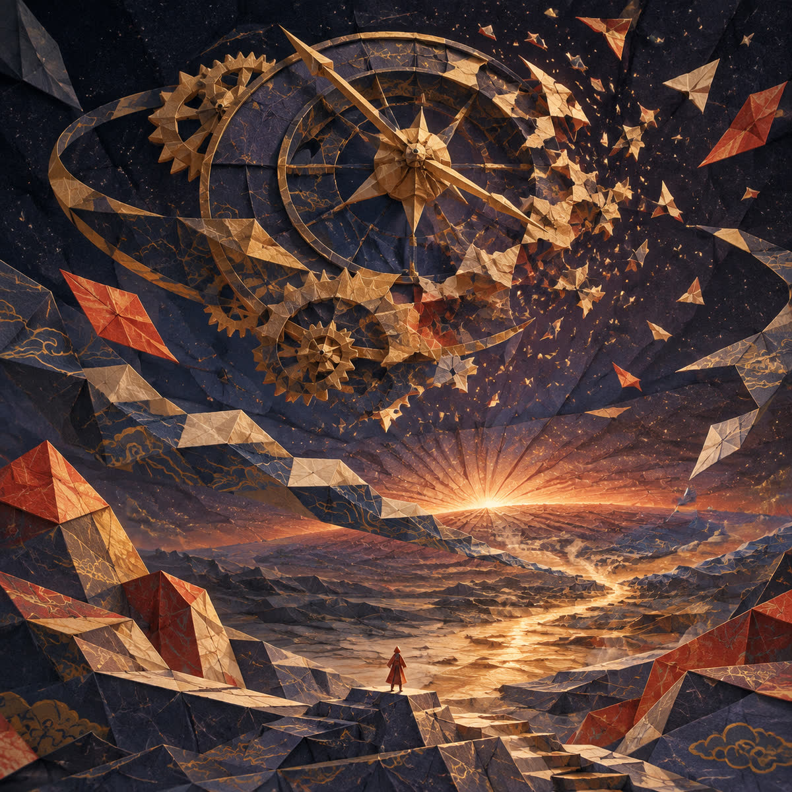

### 35 · 沙画灯箱

半透明的沙层，光穿过的厚度就是画面的明暗。

```
沙画灯箱艺术风格（sand animation on lightbox）：磨砂玻璃灯箱底部透出的暖白光从下方照亮薄薄一层细沙，沙层厚处呈深褐近黑，薄处透出琥珀金光，颗粒与刷痕、指印清晰；画面为俯视灯箱沙面，边缘有堆积的沙；天文钟用沙堆与指划勾出，齿轮是沙画出的环形刻线；崩解处沙粒正在从边缘滑落、堆成小丘；时间之河是用掌侧一抹扫出的干涸沙纹；星系坍缩为一圈被沙掩住一半的光；人影是用指甲划出的一个极小剪影，沙已从脚下流走。温暖、易逝、正在被抹去的质感，无文字、无水印。
```

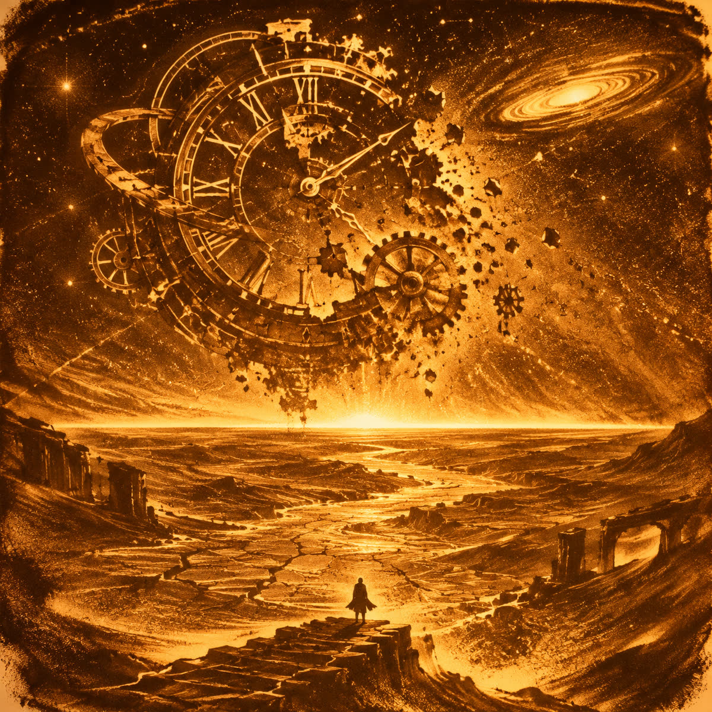

### 36 · 湿版摄影

药膜不匀的边缘，让宇宙看起来像一张十九世纪的照片。

```
湿版摄影风格（wet plate collodion, 十九世纪火棉胶玻璃底片）：边角药膜不匀、流痕与溢出的银盐边缘，不规则边框；玻璃底片上的划痕、灰尘、针孔与局部化学污点；深棕黑调（collodion warm tone），高光溢出、暗部无细节；浅景深与曝光不足的暗角；天文钟以十九世纪机械的形制呈现，齿轮厚重、铆钉与铸铁质感；崩解处呈现为运动模糊与药膜剥落；时间之河是一条被长时间曝光拉成雾状的水痕；星系坍缩为一团过曝的白色光斑；人影是一个必须静止十几秒才能成像的僵直剪影。古董感、物理缺陷之美，绝非干净数字图像，无文字、无水印。
```

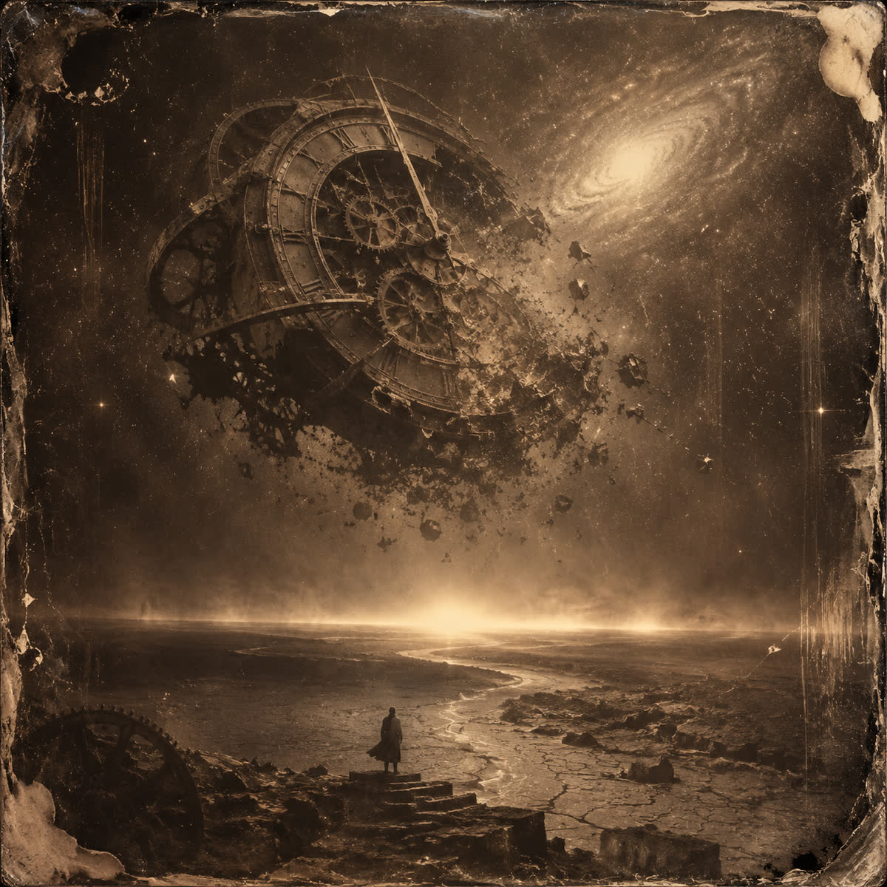

### 37 · 刺绣 / 十字绣

像素画的物理版本，线迹自带抖动。

```
十字绣风格（cross-stitch embroidery, 亚麻布上的棉线）：画面由一个个 X 形针脚构成，布纹经纬可见，线有粗细与轻微毛羽，背面走线在薄处隐约透出；配色为暗青、玫红、土黄、象牙、深褐的绣线；每个针脚的方向与张力略有差异，边缘有长短不一的线头；天文钟化为十字绣图案的环形机械，齿轮是 X 针脚围成的齿；崩解处线头散开、针脚缺失、露出布底；时间之河是横向的蓝线针脚带；星系坍缩为一圈金色缎面绣的光芒；人影是一个约六针脚高的小人。手工感、像素画的物理版本、温暖，无文字、无水印。
```

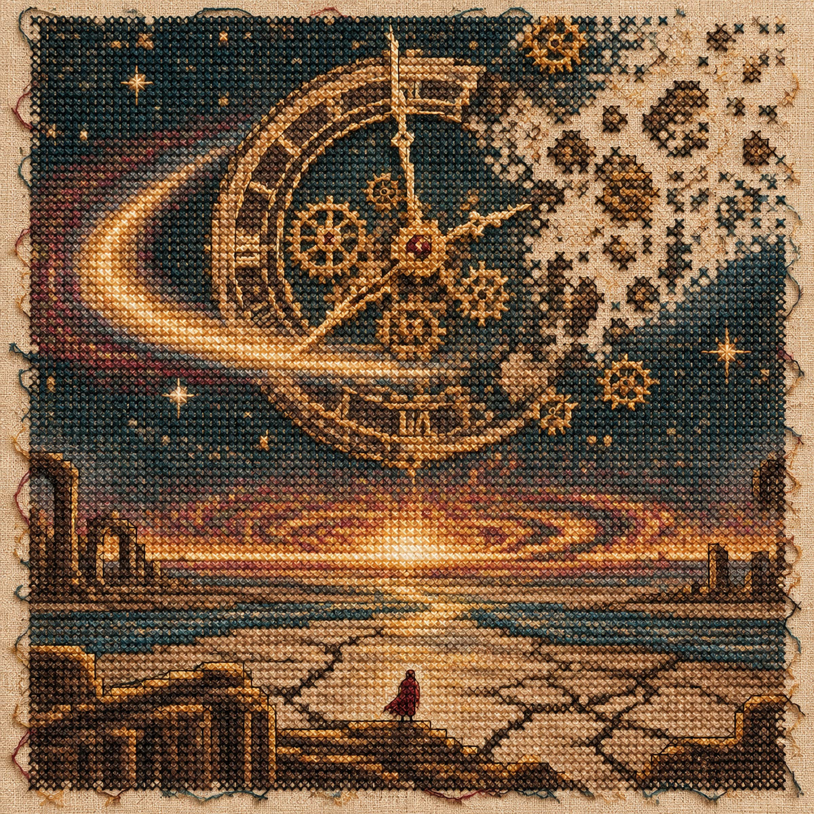

### 38 · 木刻版画

密集排线刻出暗部，刀味比浮世绘更硬。

```
木刻版画风格（woodcut, 丢勒式密集排线）：黑墨印在粗糙的手工纸上，刀味明显，线条有粗细与断口，边缘留出未刻净的木纹；只用黑白两色（加一点赭红），暗部靠极密的平行排线与交叉线刻出；纸张有压印凹痕与纤维；天文钟化为丢勒式的精密机械，齿轮用同心圆弧排线刻出体积；崩解处线条断裂、木屑飞散；时间之河是一排排刻出的水纹线；星系坍缩为一圈放射排线；人影是极小的一个背向人影，只用三笔刻出。北方文艺复兴的硬朗与忧郁，无文字、无签名、无水印。
```

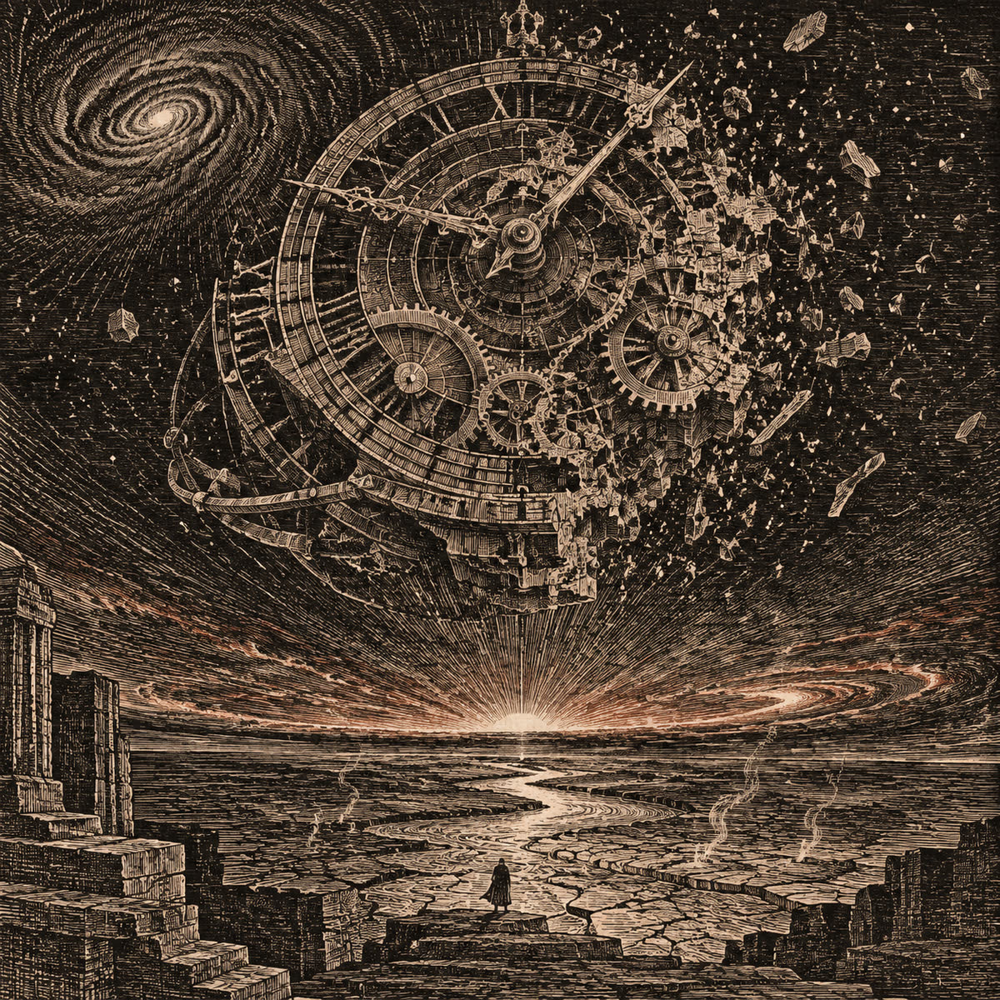

## ⑥ 媒介与尺度 

这一组不换风格，只换画布。同一段主题描述，在宽银幕、手机竖屏、展览海报上必须重新排布。

### 39 · 16:9 电影剧照

横构图，下方留出字幕安全区，人影压在左三分之一。

```
电影剧照风格（cinematic film still, 宽银幕横向构图, anamorphic 镜头）：横向宽构图，主体偏居画面一侧三分线，下半部留出字幕安全区；强烈的青橙（teal & orange）调色，浅景深，胶片颗粒与轻微镜头眩光；天文钟占据画面一侧，崩解的颗粒形成横向的光尘带；时间之河从前景延伸到地平线；星系坍缩为远处一条极细的橙线；人影极小地位于画面前景下三分之一。宽银幕电影感，像一帧被截下来的画面，无文字、无字幕、无水印。
```

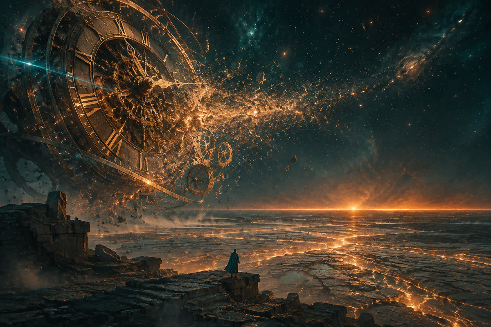

> 口径说明：请求的是 `1536x1024`，模型原样返回 **1536×1024（3:2）**，比标称的 16:9 略高一点。构图逻辑仍是宽银幕——横向延展、单侧主体、下方留字幕安全区。要真 16:9 得自己裁 1536×864，这里保留模型原图。

### 40 · 9:16 竖屏壁纸

竖屏，底部三分之一留空，主体悬在中上部。

```
竖屏手机壁纸构图（9:16 portrait wallpaper, mobile lock screen composition）：极窄竖构图，视觉重心在中上部，底部三分之一留出大片安静的深色区域；主体的天文钟悬在画面上三分之一，崩解的颗粒向上飘散，人影极小站在下方三分之一处，上下呼应；配色偏深蓝紫与暖金，高对比但不刺眼；无界面元素、无时钟 UI、无文字、无水印。
```

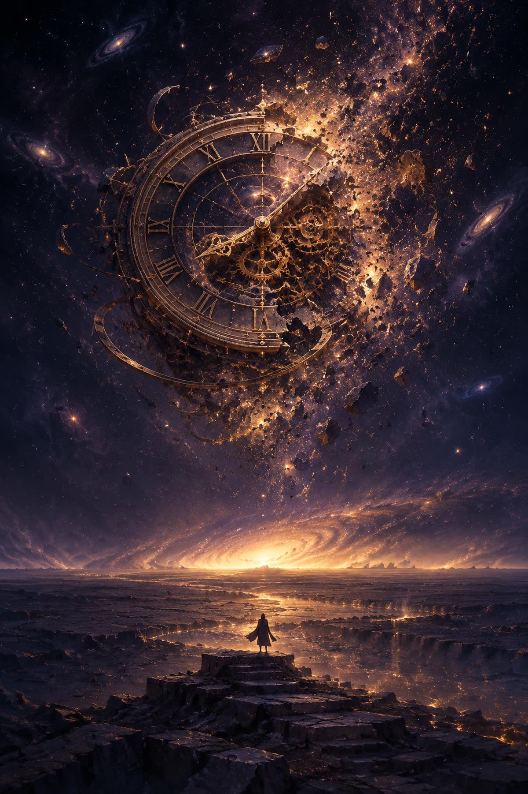

### 41 · A2 展览海报

标题压在留白处（但不写字），主体沉在下方三分之二。

```
艺术展览海报构图（A2 gallery poster layout）：竖幅，画面主体压在下方三分之二，上方三分之一是大片深色负空间，为标题预留但不写字；边缘有极细的白线与印刷裁切标记；丝网印刷的油墨厚度与纸张肌理，局部套色错位；天文钟居中偏下，崩解的颗粒向上飘进留白；时间之河是一条横向的干涸河床；人影极小位于画面最下方；整体像一张美术馆展览海报，平面化、克制、有版画油墨质感，画面中不出现任何文字、无水印。
```

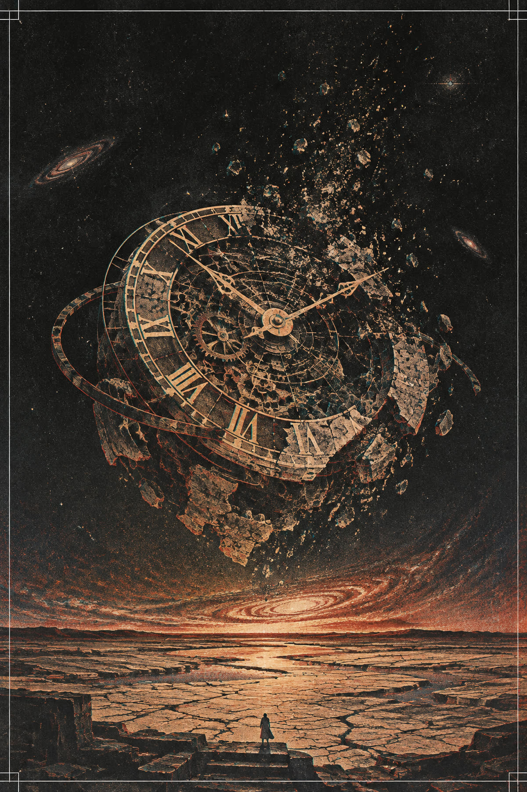

## 七、三十一张的成本表

「请求」是我传给接口的尺寸，「实际」是模型真正吐出来的像素——`1024x1024` 一律返回 **1254×1254**，`1536x1024` / `1024x1536` 则是原样返回。博客用图再统一缩到 1200px 宽、`q:v 5` 重编码。

| # | 风格 | 组 | 请求 | 实际出图 | 耗时 | 原始 PNG |
| --- | --- | --- | --- | --- | --- | --- |
| 11 | 工笔重彩 | 东方工艺 | `1024x1024` | 1254×1254 | 29s | 3805 KB |
| 12 | 青花瓷 | 东方工艺 | `1024x1024` | 1254×1254 | 36s | 3620 KB |
| 13 | 敦煌壁画 | 东方工艺 | `1024x1024` | 1254×1254 | 33s | 4080 KB |
| 14 | 剪纸 | 东方工艺 | `1024x1024` | 1254×1254 | 44s | 2964 KB |
| 15 | 琳派金箔屏风 | 东方工艺 | `1024x1024` | 1254×1254 | 25s | 3295 KB |
| 16 | 文艺复兴湿壁画 | 艺术史 | `1024x1024` | 1254×1254 | 46s | 3529 KB |
| 17 | 拜占庭马赛克 | 艺术史 | `1024x1024` | 1254×1254 | 42s | 4436 KB |
| 18 | 巴洛克天顶画 | 艺术史 | `1024x1024` | 1254×1254 | 36s | 3357 KB |
| 19 | 中世纪泥金手抄本 | 艺术史 | `1024x1024` | 1254×1254 | 51s | 4133 KB |
| 20 | 哥特彩窗 | 艺术史 | `1024x1024` | 1254×1254 | 39s | 3849 KB |
| 21 | 超现实主义 | 艺术史 | `1024x1024` | 1254×1254 | 32s | 2661 KB |
| 22 | Art Deco | 平面设计 | `1024x1024` | 1254×1254 | 26s | 3247 KB |
| 23 | 瑞士国际主义 | 平面设计 | `1024x1024` | 1254×1254 | 42s | 2790 KB |
| 24 | 1970s 太空歌剧平装书封面 | 平面设计 | `1024x1024` | 1254×1254 | 42s | 3650 KB |
| 25 | 苏联构成主义 | 平面设计 | `1024x1024` | 1254×1254 | 25s | 3866 KB |
| 26 | 蓝图 / CAD 图纸 | 平面设计 | `1024x1024` | 1254×1254 | 26s | 3598 KB |
| 27 | 波普艺术 | 平面设计 | `1024x1024` | 1254×1254 | 31s | 3853 KB |
| 28 | Low-poly 低多边形 | 数字材质 | `1024x1024` | 1254×1254 | 24s | 2207 KB |
| 29 | Voxel 体素 | 数字材质 | `1024x1024` | 1254×1254 | 22s | 2754 KB |
| 30 | 3D 粘土渲染 | 数字材质 | `1024x1024` | 1254×1254 | 35s | 2507 KB |
| 31 | 线框 Wireframe | 数字材质 | `1024x1024` | 1254×1254 | 21s | 2813 KB |
| 32 | 点云 / ASCII | 数字材质 | `1024x1024` | 1254×1254 | 22s | 2836 KB |
| 33 | 乐高积木 | 材料实验 | `1024x1024` | 1254×1254 | 34s | 2433 KB |
| 34 | 折纸 | 材料实验 | `1024x1024` | 1254×1254 | 32s | 3071 KB |
| 35 | 沙画灯箱 | 材料实验 | `1024x1024` | 1254×1254 | 27s | 3349 KB |
| 36 | 湿版摄影 | 材料实验 | `1024x1024` | 1254×1254 | 28s | 2824 KB |
| 37 | 刺绣 / 十字绣 | 材料实验 | `1024x1024` | 1254×1254 | 24s | 4531 KB |
| 38 | 木刻版画 | 材料实验 | `1024x1024` | 1254×1254 | 26s | 4434 KB |
| 39 | 16:9 电影剧照 | 媒介与尺度 | `1536x1024` | 1536×1024 | 22s | 2936 KB |
| 40 | 9:16 竖屏壁纸 | 媒介与尺度 | `1024x1536` | 1024×1536 | 38s | 2758 KB |
| 41 | A2 展览海报 | 媒介与尺度 | `1024x1536` | 1024×1536 | 25s | 3581 KB |

合计 **31 张 / 生成 16 分钟 / 101 MB 原始 PNG**，转成 1200px 宽的 JPG 后是 13.5 MB。

## 八、这一轮新学到的

第一篇的十条依然成立，这里只补第一批没遇到过的：

1. **材料名比风格名管用。** 写「乐高」不如写「带凸点的塑料积木、有注塑分模线、微距浅景深」；写「沙画」必须写「灯箱从下往上打光、沙层厚处近黑、薄处透琥珀」。工艺细节一给，模型就不再给你一张「风格滤镜」。
2. **风格要翻译，不能贴图。** 青花瓷只存在于瓷器上，所以整幅变成了瓷板画、梅瓶、莲瓣边框；敦煌壁画必须有地仗层、剥落和烟熏。直接把原物贴进「油画布」会得到拼贴感很重的假图。
3. **平面设计组成败全在删。** 瑞士国际主义那段的写法是主动把天文钟压到「一个圆＋几道线」，并直接写「只剩最必要的结构信息」；不这么写，模型一定会给你堆满装饰，因为「末日」在它的先验里就等于「繁复」。
4. **尺寸不是裁切，是重排。** 9:16 的人影必须放在下三分之一、主体悬在上三分之一；16:9 要留字幕安全区。同一段主题描述直接换个画幅，会得到一张「被裁过的方图」。
5. **「材质类」风格要交代生成规则。** 点云/ASCII 那张，关键句是「字符亮度随形体明暗变化」；线框那张是「背面线以更低亮度呈现」。只写「ASCII 风格」，模型会给你一张带文字噪点的画。
6. **降级链要提前写进脚本，但这次没用上。** 三十一张全部由 `gpt-image-2.6` 一次出图，零失败、零重试——上一批（十种风格）时遇到过上游 `503 No available channel`，所以脚本里预置了 `2.6 → 2.5-flare → 2.5-sunburst` 的降级链和两次重试；这次它只是待命。**报喜也要报口径**：没发生的事不写进复盘。
7. **横竖尺寸都能请求，但耗时不稳定。** `1536x1024` 与 `1024x1536` 都可用（探测时单张 38-40 秒，本轮实测 22s / 38s / 25s），和正方形同量级波动。批量时把同尺寸排在一起，能少几次切换，也方便统一核对「请求尺寸 ≠ 实际尺寸」这件事。

## 写在最后

这三十一段里最值得先试的是**沙画灯箱**和**湿版摄影**：它们天生带着「正在被抹去」的物理痕迹——沙会从边缘滑落，药膜会自己剥落——而这恰好就是主题本身。风格从来不是一层皮，它是另一个宇宙的物理法则：在乐高的宇宙里，时间是塑料的；在沙画的宇宙里，时间是被手指抹开的。

> 全部图像为 AI 输出，本文提示词可自由取用、改写、再生成。第一批十种见 《[提示词全记录](/2026/11/09/时间的尽头-提示词全记录/)》，交互作品见 《[时间的尽头](/2026/11/09/时间的尽头-交互宇宙作品/)》。
