《[时间的尽头](/2026/11/09/时间的尽头-交互宇宙作品/)》最初只有一句话。

后来这句话长出了一个可以在浏览器里拖动的宇宙，又长出了十张同一主题、十种语言的画。这篇把中间那些东西全部摊开：**两句提示词、十个风格层、一套文案，以及每一个环节用的是哪个模型**。不保留秘诀，因为秘诀本来就不在提示词里，而在你愿意为一个画面反复描述多少次。

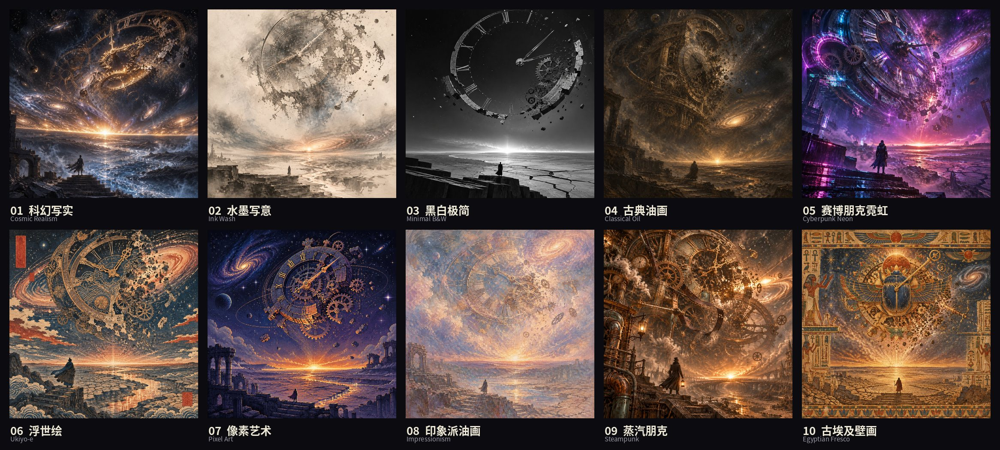

> 后续：**第二批**已经跑完——六组风格、三十一种画，见《[时间的尽头 · 六组风格实验](/2026/11/10/时间的尽头-六组风格实验/)》。

## 一、交互作品的提示词

模型：**gpt 6.1 sol**

这是我在对话框里输入的完整原文，一字未改：

```
请使用 Three.js 创作一个主题为《时间的尽头》的 3D 交互式网页。 充分发挥你最顶级的审美、艺术设计和 3D 编程能力，在构图、光影、材质、粒子、动画和空间氛围上做到极致。画面需要有令人震撼的视觉表现力，并且可以通过鼠标自由交互。 不限制你的创意和技术方案，尽可能展示你的能力上限。请直接完成开发、运行和测试，交付一个真正可玩的作品。
```

只有五句话，但每一句都在关掉一个默认行为：

| 句子 | 实际作用 |
| --- | --- |
| 「请使用 Three.js」 | 锁定技术栈，避免退化成 Canvas 2D 或一段视频 |
| 「顶级的审美、艺术设计……构图、光影、材质、粒子、动画、空间氛围」 | 把"好看"拆成六个可执行的维度，模型无法用"整体氛围感"糊过去 |
| 「可以通过鼠标自由交互」 | 从"一张会动的图"变成"一个可操作的空间" |
| 「不限制你的创意和技术方案，尽可能展示你的能力上限」 | 放开自我审查——不给它"这是不是太复杂了"的退路 |
| 「直接完成开发、运行和测试，交付一个真正可玩的作品」 | 最关键的收尾：要跑起来、要测过，而不是交一段代码让我自己接 |

结果是：没有图片素材、没有模型文件、没有音频文件，全部由 GLSL 与粒子算出来；三个纪元、五秒穿越、实时合成环境音；1600 × 1000 无头 Chrome 实测 **57 FPS**，运行时远程请求 **0**。

一句经验：**与其反复要求"更好看"，不如指定"好看"由哪几个可验证的部分组成。**

## 二、图像的提示词

模型：**gpt-image-2.6**（当时网关里唯一可用的图像模型），`size: 1024x1024`，实际出图 **1254 × 1254**。

十张图不是十次独立创作，而是**一次主题固定 + 十次风格替换**。所以提示词被拆成两段：

### 公共主题段（每张图都完整复述一遍）

```
主题《时间的尽头》：宇宙最后时刻。一座半溶解的巨型天文钟悬浮在虚空中，齿轮与指针崩解成飞散的颗粒；
钟下方是一条干涸的时间之河，河床龟裂，最后一点液态光正在蒸发；远处星系坍缩成一条地平线，
星辰逐颗熄灭只剩余晖；画面底部一个极小的人影站在断裂的石阶上，背向镜头，仰望消失的光。
```

五个锚点，缺一个画面就散：**半溶解的天文钟 / 干涸的时间之河 / 坍缩成线的星系 / 逐颗熄灭的星 / 极小的人影**。人影的"极小"尤其重要——它是画面的比例尺，也是唯一的情绪出口。

因为图像模型**没有跨次记忆**，这十行必须在每一次请求里重贴。指望它"记得上一张"，只会得到十个互不相干的宇宙。

### 十个风格层（只换这一段）

**01 · 科幻写实**——起点，一段中英混排的"电影剧照"式描述：

```
《时间的尽头》/ The End of Time. A vast cosmic landscape at the very last moment of the universe:
an immense, half-dissolved astronomical clock mechanism floating in dark space, its gears and hands
crumbling into drifting golden dust. Below it, a dried-up river of time — a crystalline riverbed where
the last drops of liquid light evaporate into cold blue mist. A colossal ring of exhausted galaxies
slowly collapsing into a single horizon line, stars going out one by one, leaving faint afterglow trails.
A tiny lone human silhouette stands on a broken stone stair at the bottom edge, facing the vanishing light,
dwarfed by scale, wrapped in a thin wind-blown coat. Cinematic composition, ultra-wide, volumetric light,
deep indigo and obsidian black palette with ember orange and pale gold accents, dust particles,
hyper-detailed, surreal cosmic realism, melancholic and serene, 8k, film grain, dramatic contrast,
no text, no watermark.
```

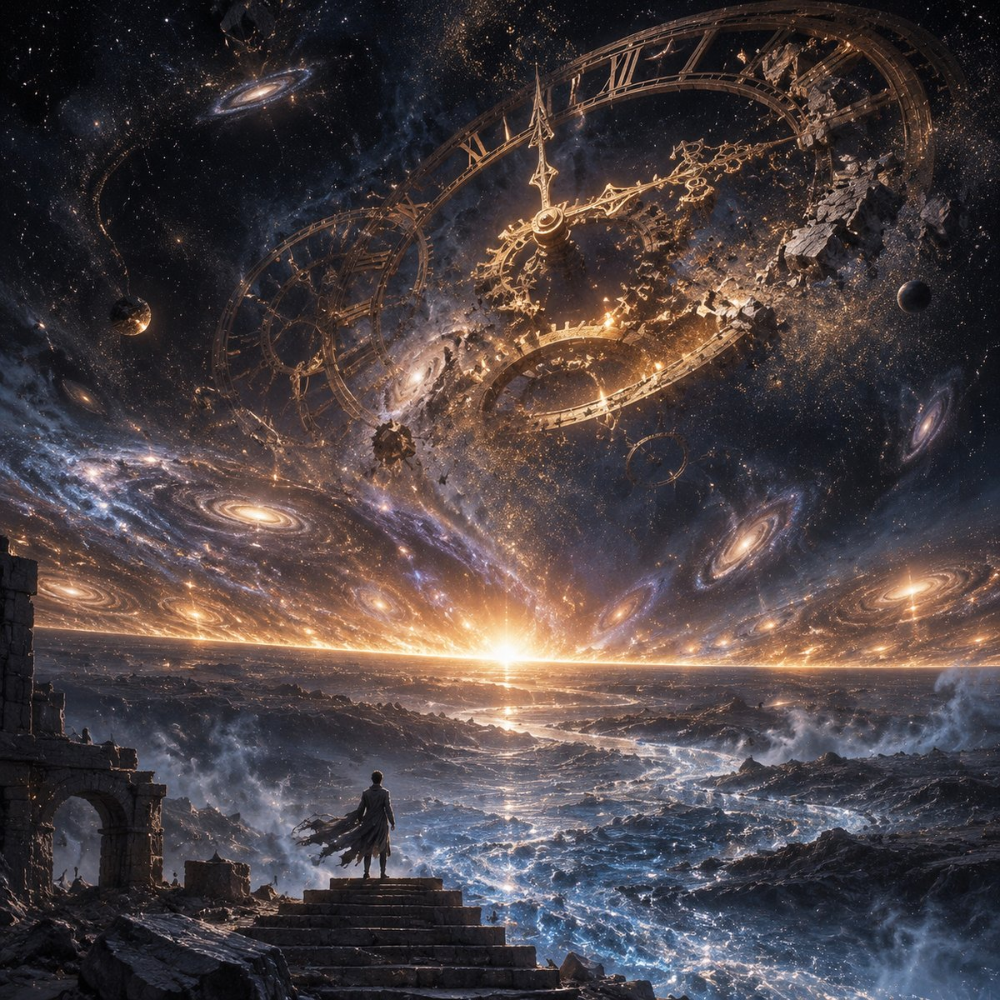

**02 · 水墨写意**

```
中国传统水墨写意风格（shuimo / ink wash painting）：宣纸质感，焦墨、泼墨、飞白笔触，
大量留白表现虚空，只用极淡的花青与赭石做一点点晕染；天文钟以细笔白描勾出轮廓后局部化开；
人影是极小的一点浓墨。意境萧疏、苍茫、克制，题款式构图，无文字。
```

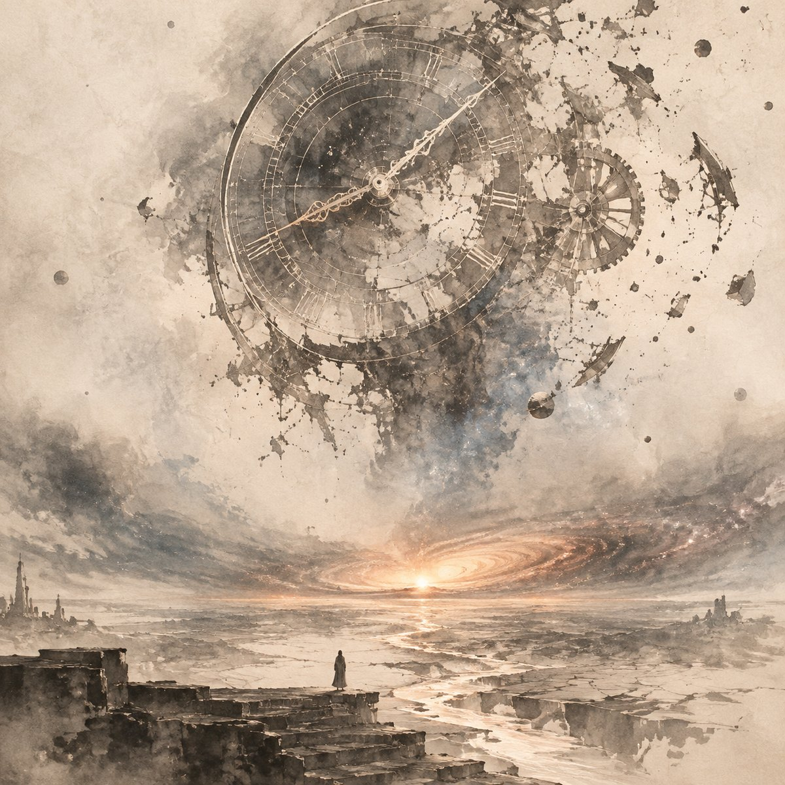

**03 · 黑白极简**

```
冷峻极简黑白摄影风格（minimalist black and white, brutalist）：纯黑白灰阶，高对比，
大面积负空间，几何化的构图，天文钟被抽象成一圈巨大的、正在断裂的金属环与刻线；
河床是几条克制的裂纹几何线条；人影是一个小到近乎符号的剪影。无渐变噪点，极致干净，
像建筑摄影与观念摄影的结合，无文字、无水印。
```

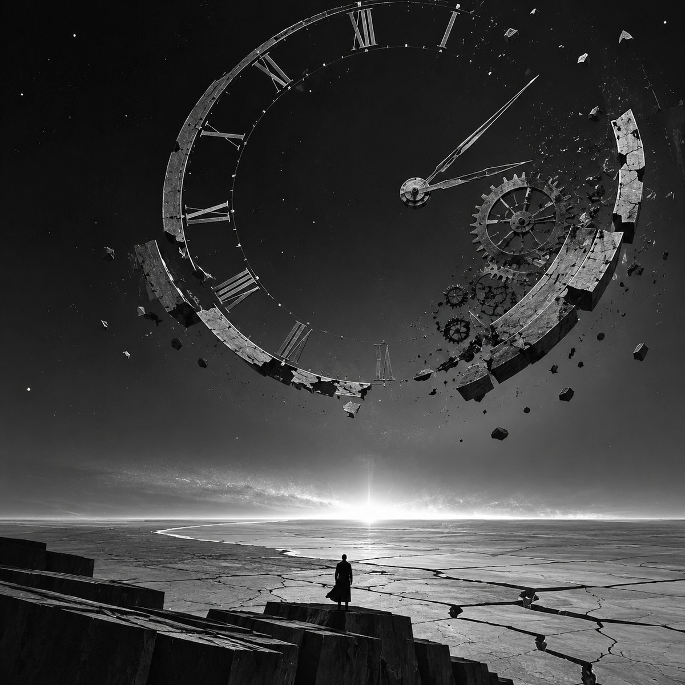

**04 · 古典油画**

```
古典油画风格（classical oil painting, chiaroscuro）：厚涂笔触与可见的画布纹理，伦勃朗式明暗对比，
深褐、暗金、铅灰与冷蓝的古老色调，天文钟如巴洛克机械般层层堆叠并正在朽坏，
时间之河是翻涌的暗色颜料，星系坍缩处有烛火般的光晕；人影裹着破旧长袍，渺小孤绝。
博物馆级油画质感，庄严、肃穆、忧郁，无文字、无签名。
```

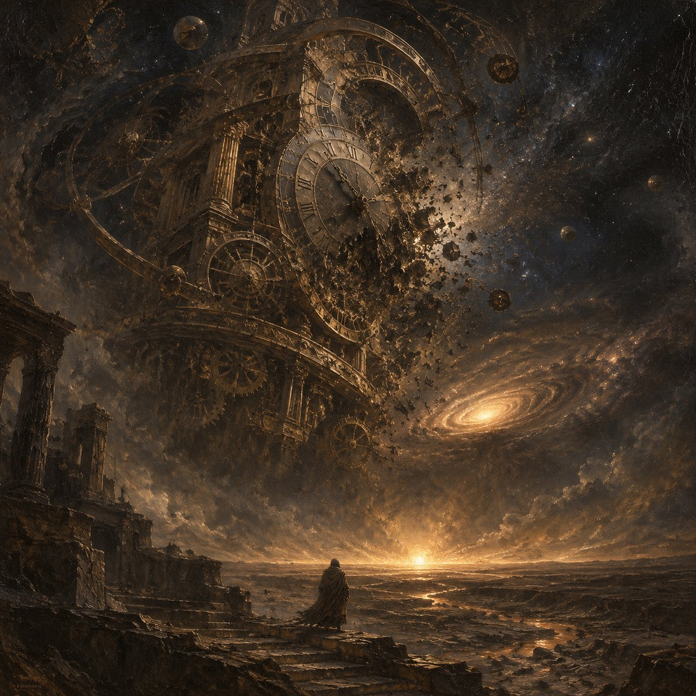

**05 · 赛博朋克霓虹**

```
赛博朋克霓虹风格（cyberpunk neon, blade-runner aesthetic）：午夜雨夜，霓虹主导的调色——
洋红、青蓝、酸紫交织，高饱和高对比；天文钟是布满全息投影与故障像素（glitch）的巨大机械装置，
齿轮边缘有 LED 灯带与扫描线；时间之河是一条反射霓虹的湿滑街道，积水倒映招牌光斑；
星系坍缩处在雾中散出体积光束；人影披着带反光条的外套，站在钢筋台阶上，被逆光勾出轮廓。
雨丝、光晕、镜头眩光、胶片颗粒，赛博朋克电影感，无文字、无水印。
```

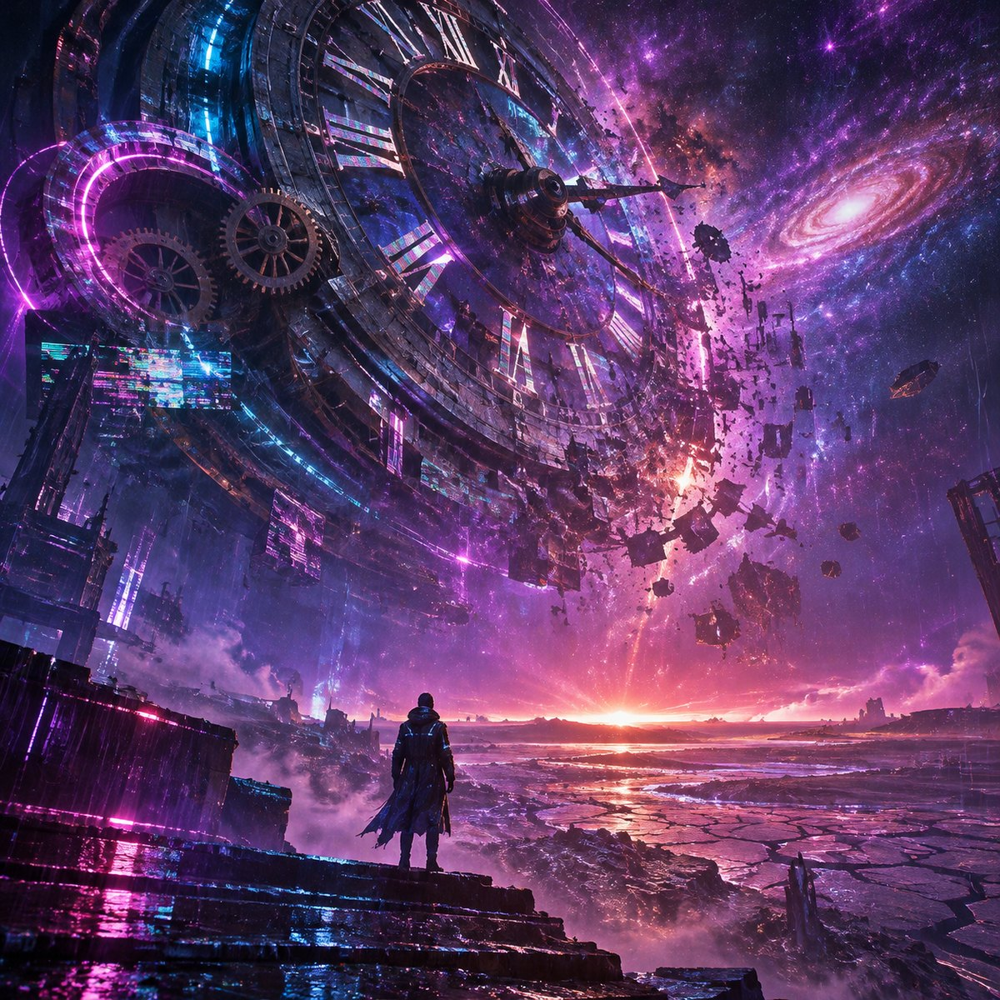

**06 · 浮世绘**

```
日本浮世绘木版画风格（ukiyo-e woodblock print, Hokusai / Hiroshige）：平涂色块，
清晰的墨线轮廓，和纸纹理与木版压印的细微不匀；配色取自传统—— Prussian blue（ベロ藍）、
朱红、土黄、墨黑，层层叠印；天文钟化作华丽的和式机关装置，齿轮纹样似家徽与青海波；
时间之河用经典的流水纹样表现，波纹成排；星系坍缩成一圈晕染的霞光；
人影是穿和服的旅人剪影，站在断阶上远望。构图带题签位置与朱印，江户时代版画气息，无文字。
```

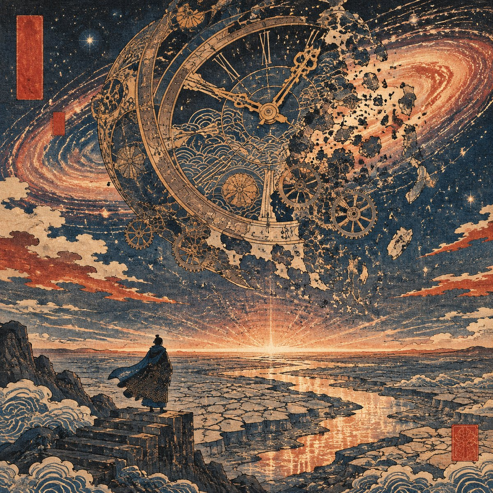

**07 · 像素艺术**

```
精细像素艺术风格（pixel art, 32-bit era, limited palette）：严格像素网格，硬边缘无抗锯齿，
使用受限调色板——深蓝紫、暗青、琥珀橙、金属灰，配合有序抖动（dithering）表现渐变；
天文钟由像素块拼成，齿轮有 1px 高光，崩解的碎屑是散落的亮点；时间之河是层叠的像素波纹；
星空以稀疏亮点与十字星芒暗示；人影只有十几个像素高，剪影可辨。
复古游戏美术质感，像 90 年代高分辨率 DOS 游戏场景，无文字、无水印。
```

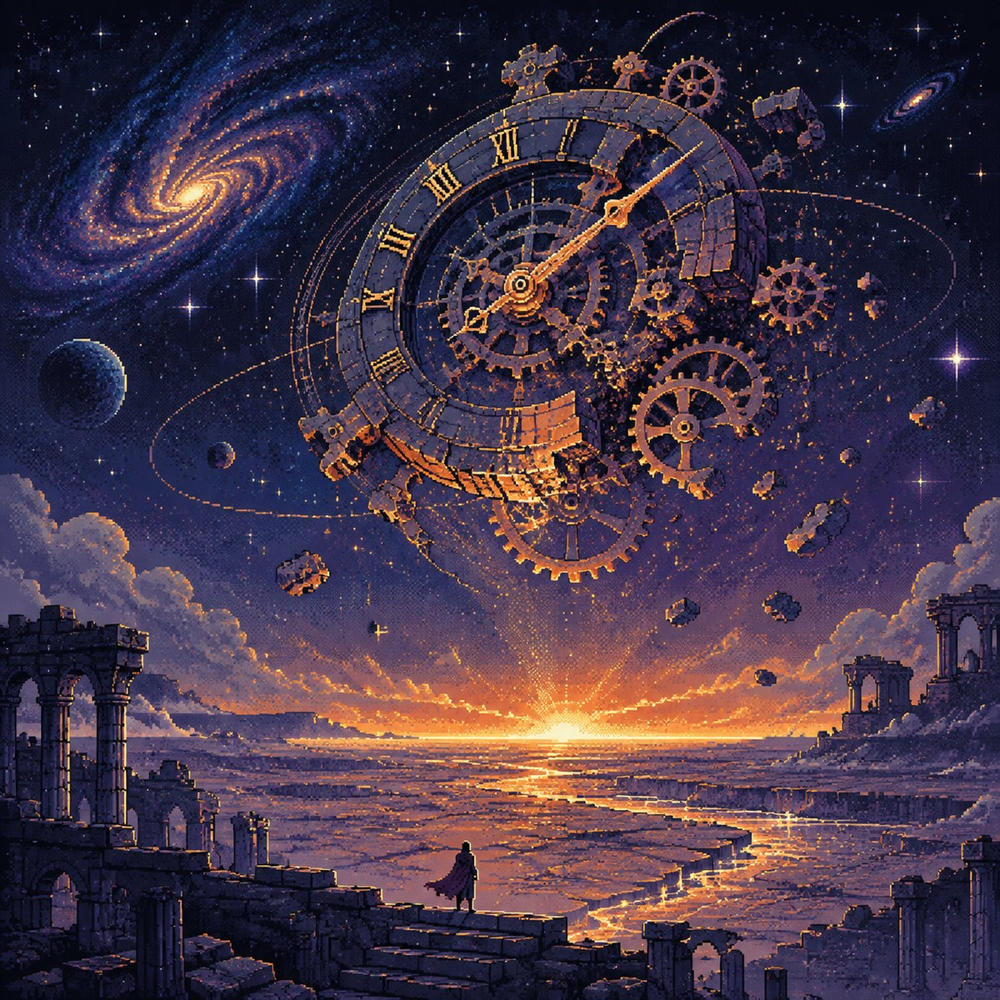

**08 · 印象派油画**

```
法国印象派油画风格（impressionism, Monet / Pissarro / late Turner）：可见的短促笔触与破碎色彩，
颜料厚薄不匀，边缘柔化溶解，靠并置的色点让眼睛自己混色；不画清晰轮廓，只抓光的变化；
暮色与晨曦交织的色谱——玫瑰灰、雾蓝、奶黄、淡紫、赭石，光晕层层叠叠；
天文钟在雾中若隐若现，齿轮化作旋转的笔触漩涡；时间之河是闪烁的蓝紫倒影；
星系坍缩为一团温柔的暖光；人影只是寥寥几笔的深色剪影。绘画性强，有画布纹理与光线颤动感，
十九世纪沙龙油画气质，无文字、无签名。
```

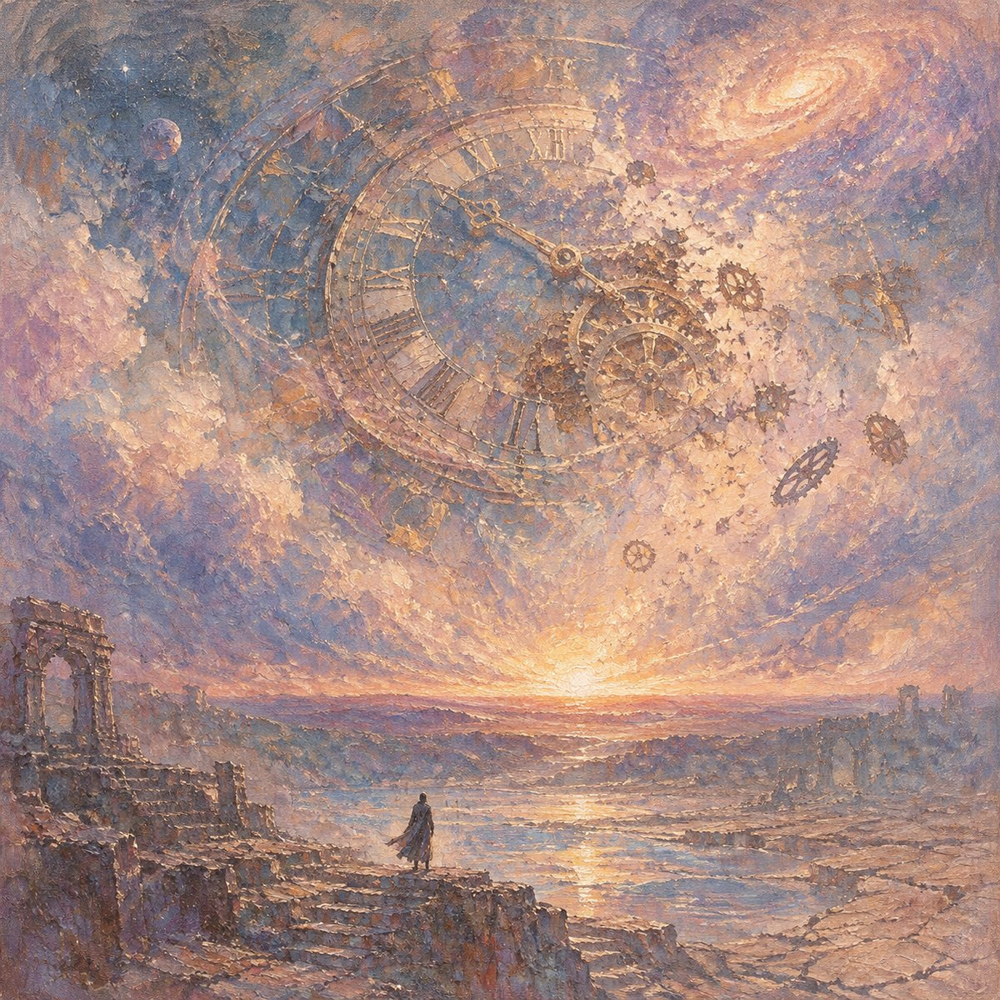

**09 · 蒸汽朋克**

```
维多利亚蒸汽朋克风格（steampunk, brass and copper machinery）：黄铜、紫铜、氧化铜绿、旧皮革与深色木材；
天文钟是巨大的维多利亚机械装置——铆钉钢板、铜管、压力表盘、飞轮、黄铜齿轮层层嵌套，
蒸汽从接头处喷出，皮带传动正在断裂；齿轮与指针崩解成飞散的金属屑与齿轮碎片；
时间之河是一条干涸的运河，河床露出锈蚀的管道与铜制阀门，残余流体泛着机油光泽；
星系坍缩处是一圈铜色光晕与蒸汽云；人影穿维多利亚式长风衣、戴护目镜与礼帽，站在铸铁台阶上，
手提一盏油灯。暖棕色主调 + 铜绿点缀，体积雾、光束、机械细节繁复，无文字、无水印。
```

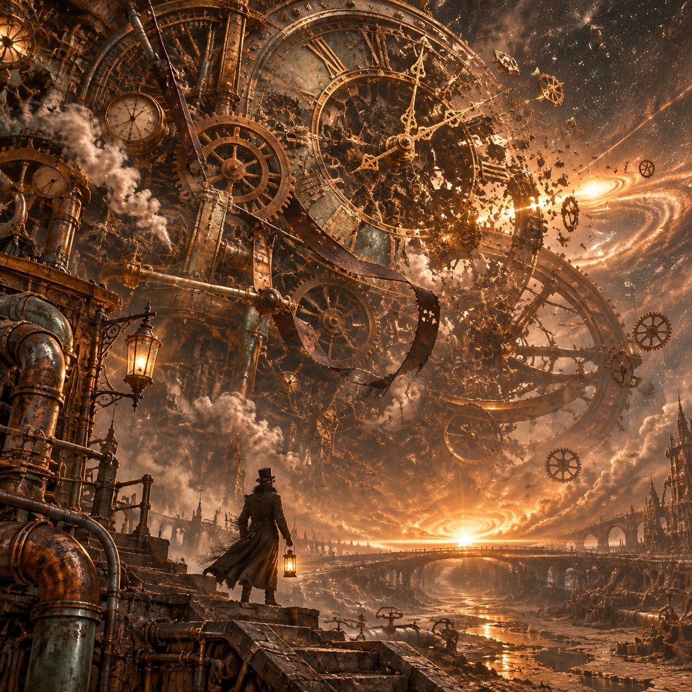

**10 · 古埃及壁画**

```
古埃及墓室壁画风格（ancient Egyptian tomb fresco, New Kingdom）：矿物颜料平涂于灰泥与纸莎草上，
剥落与裂纹的做旧质感；人物与物体以侧面律（profile）呈现，比例象征化；
水平分层的带状构图（register），上下以彩色饰带分隔；配色为经典矿物色——
埃及蓝（lapis/ Egyptian blue）、孔雀石绿、赭黄、赤铁红、石膏白、炭黑，勾以深褐轮廓线；
天文钟化为巨大的圣甲虫与日轮结合的仪式机械，齿轮似莲花与蛇形纹样，指针如权杖；
时间之河以锯齿状水纹符号表现；星系坍缩为带翼日轮；人影是侧身站立的祭司，双手举向天空。
墙面可见装饰性象形符号作为边框装饰（非可读文字），庄严、仪式感、考古壁画气息，无水印。
```

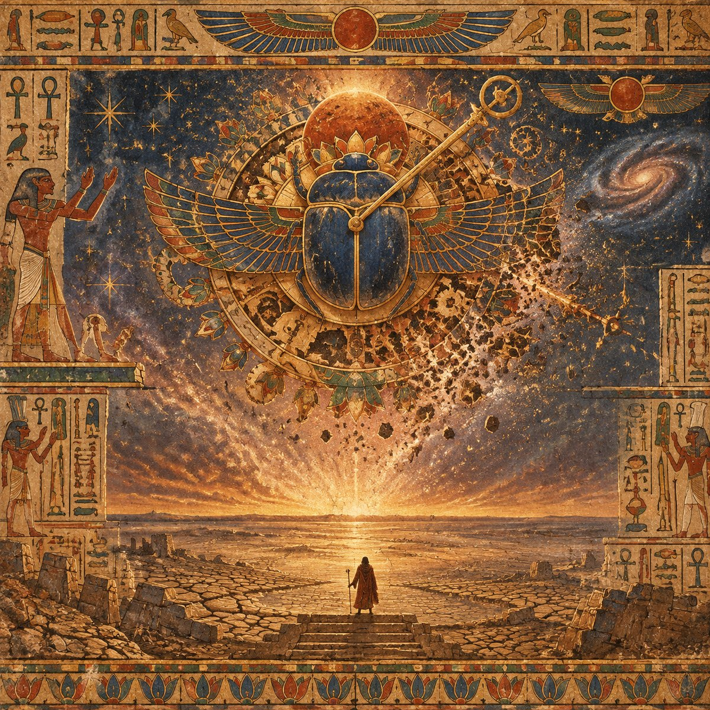

### 十条可复用的写法

1. **先给风格一个专有名词**，再给中文解释。`ukiyo-e`、`chiaroscuro`、`steampunk` 这类词在训练数据里挂着整片视觉传统，比十句形容词管用。
2. **风格层永远带具体材料**：宣纸、木版压印、铆钉黄铜、矿物颜料、像素网格。材质是风格的骨头。
3. **给调色板点名**：不要说"色彩高级"，要说"埃及蓝、孔雀石绿、赭黄、赤铁红"。
4. **把主题"翻译"进风格**：浮世绘里天文钟变和式机关，埃及壁画里变圣甲虫与日轮。直接贴原物会得到一张拼贴感很重的图。
5. **风格一致性靠收尾约束**：`无文字、无水印` 每次都要写，否则中文标题会自己长出来。
6. **比例尺不能丢**：每张都保留"极小的人影"，风格再换，尺度感还在。
7. **一次只改一个变量**：主题段一个字都不动，画风才可比。
8. **串行请求**，别并发——单张 20～50 秒，串行更容易定位是哪一句出了问题。
9. **落盘后校验**：读 PNG 魔数 + 尺寸，别相信"成功"两个字。
10. **接受废稿**：十种里能用的可能只有六种，剩下四张是风格研究费。

## 三、文案

画面之外，这个作品一共有三层文字：**纪元名、交互反馈、和一句被删掉的话**。

### 那句话

```
不要害怕。光会带你去往另一边。
```

它原本是穿越奇点时的弹窗。上线后我把它删了——因为五秒的穿越本身已经把这句话说完了，再弹一行字，等于替观众解释自己的感动。**好的文案是删出来的**，所以我把它留在这里，作为不出现的那一行。

### 三个纪元

| 纪元 | 副文案 |
| --- | --- |
| 第一纪元 · 最后的恒星 | 在无尽长夜之前，再看一眼星光。 |
| 第二纪元 · 时间的尽头 | 当最后一颗恒星熄灭，宇宙终于学会了安静。 |
| 第三纪元 · 另一个黎明 | 时间再次呼吸，光有了新的名字。 |

三句都遵守同一条规则：**一句一个动作**（再看、安静、呼吸），不解释设定。

### 交互反馈

- 双击画布：`引力涟漪，正在穿过你。`
- 穿越完成：`你穿过了终点。欢迎来到另一段时间。`
- 冻结时间：`此刻，时间为你停留。`
- 留住画面：`已留住这一瞬间。`

### 那首诗

```
从一粒不肯沉默的尘埃，
每一束尚未熄灭的光，
都是宇宙写给黑暗的信。
```

### 关于文案的三条原则

1. **短句，动词结尾。** "宇宙终于学会了安静"比"宇宙进入了静止状态"更像人话。
2. **不解释物理。** 作品里的宇宙年龄、温度都是叙事设定，文案不承担科普义务。
3. **留一行不说的。** 被删掉的那句，往往是最该存在的那句。

## 四、模型清单

| 环节 | 模型 | 参数 |
| --- | --- | --- |
| 交互式 3D 网页（Three.js / GLSL / 音频） | **gpt 6.1 sol** | 一句提示词，一次交付，含开发、运行与测试 |
| 主题插画 × 10 | **gpt-image-2.6** | `size: 1024x1024`，输出 1254 × 1254，单张 20～51 秒 |

## 五、源码

这个作品的源码也在博客仓库里，和文章一起管理：

```
end-of-time-src/          # 源码（约 990 行手写代码）
├── index.html
├── src/main.js           # 场景装配、相机、纪元切换、穿越
├── src/shaders.js        # 全部 GLSL
├── src/sound.js          # Web Audio 程序化环境音
├── src/style.css
├── vite.config.js        # base: '/end-of-time/'
└── server.mjs
```

```bash
npm ci && npm run dev     # http://localhost:5173
npm run build             # 产物 → dist/ → 复制到 source/end-of-time/
```

源码 → [github.com/honor-99/honor-99.github.io/tree/source/end-of-time-src](https://github.com/honor-99/honor-99.github.io/tree/source/end-of-time-src)

博客里的 `source/end-of-time/` 是构建产物，`end-of-time-src/` 是它的来源。改前者等于改缓存，改后者才是改作品。

## 写在最后

一句提示词能给出一个能跑的作品，但给不出"为什么是这个作品"。前者是模型的能力，后者是你必须自己带进去的东西——一个不肯让它变成静止句号的执念。

所以我把终点做成了入口。

> 所有生成图像均为 AI 输出，本文的提示词可自由取用、改写、再生成。
